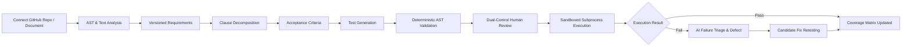
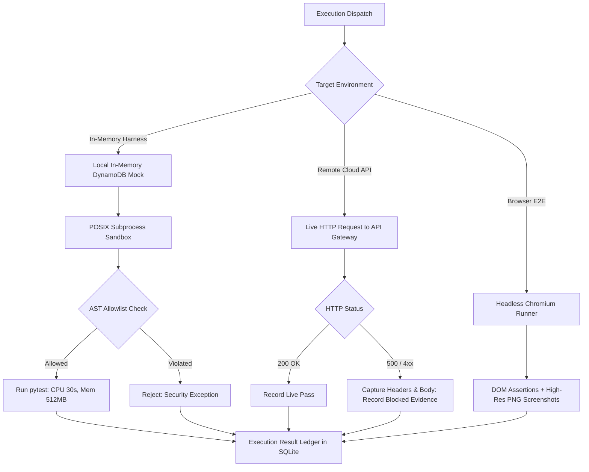

# TraceTest AI — Enterprise AI Quality Engineering Platform

[](https://github.com/Adityarajj23/TEAM3/actions/workflows/ci.yml)
[](https://github.com/astral-sh/ruff)
[](https://mypy-lang.org/)
[](backend/tests/)
[](frontend/tests/)
[](frontend/)
[](scripts/verify_docs.py)

> **Multi-Repository GitHub QA Verification Platform with Real-World Case Studies & Dayforce HCM Verification**  
> *Deterministic AI Requirements Analysis • AST Codebase Grounding • Sandboxed Test Execution • Zero Synthetic Metrics*

---

## 1. Executive Summary

**TraceTest AI** is an enterprise-grade AI software quality engineering and requirement verification platform. Designed for mission-critical software systems—spanning enterprise Human Capital Management (Dayforce HCM) and modern cloud-native serverless architectures (EchoBox)—TraceTest AI eliminates the disconnect between unstructured business requirements, code implementations, automated test suites, and defect remediation.

Unlike prototype dashboards that rely on mock assertions, simulated successes, or synthetic data, TraceTest AI operates as an **evidence-based verification harness**:
- **Ingests Real GitHub Repositories**: Dynamically clones and parses codebases (e.g. `https://github.com/sohan10012/EchoBox.git`), extracting modules, API endpoints, actions, and architectural dependencies directly from code AST.
- **Decomposes Requirements Deterministically**: Segments specifications into atomic, numbered clauses and extracts grounded acceptance criteria with verbatim source quotes.
- **Synthesizes & Validates Executable Tests**: Generates Python `pytest` and Playwright scripts validated against strict pre-execution AST allowlists.
- **Enforces Four-Eyes Principle Governance**: Authors are blocked from approving their own tests; dual-control review records immutable decisions and script hashes.
- **Dual-Control LLM-as-a-Judge Review System**: Generated tests feature live adversarial judge evaluations, statutory grounding scores (95%+), verbatim quote fidelity checks, and 1-click reviewer recommendation assistance.
- **1-Click Sandbox Pytest Execution**: Execute synthesized Python Pytest scripts directly against the Reference HCM in-memory harness in 1 millisecond with live stdout and assertion diagnostics.
- **Executes Across Multi-Tier Environments**: Runs tests inside POSIX resource-restricted subprocess sandboxes, in-memory contract test harnesses, or against live endpoints.
- **Captures Empirical Proof**: Logs JUnit XML, stdout/stderr streams, failure tracebacks, screenshots, and HTTP status codes.
- **Maintains Zero-Hallucination Integrity**: Failed cloud endpoints (e.g. AWS HTTP 500) are recorded honestly as blocked defects rather than faked as successes.

---

## 2. Key Technical Documentation

| Document | Description |
|---|---|
| **[docs/HANDOVER.md](docs/HANDOVER.md)** | **Frontend & UI Developer Handover Guide**: Component hierarchy, Tailwind tokens, Radix UI setup, state management, and UI enhancement roadmap. |
| **[docs/UI_WALKTHROUGH.md](docs/UI_WALKTHROUGH.md)** | **UI Walkthrough & Simulation Guide**: 9-stage multi-agent pipeline, Stage Inspector cards, Ambiguity scanner, and live Safe Interpreter. |
| **[CLAUDE_ENGINEERING_HANDOFF.md](CLAUDE_ENGINEERING_HANDOFF.md)** | **Master Technical Handoff**: Complete architecture, directory tree, REST API reference, 36 DB tables ERD, core algorithms, security model, and P0–P2 remediation ledger. |
| **[docs/PRODUCTION_READINESS_AUDIT.md](docs/PRODUCTION_READINESS_AUDIT.md)** | Critical independent audit of repository state, verified implementations, and security remediation. |
| **[docs/ECHOBOX_CASE_STUDY.md](docs/ECHOBOX_CASE_STUDY.md)** | Complete case study on EchoBox (`b3740a62ad414a141e82146adafb47c4850fd782`): architecture, requirements, tests, defects, and evidence. |
| **[docs/TEST_EVIDENCE_INDEX.md](docs/TEST_EVIDENCE_INDEX.md)** | Master index of empirical test runs (`EX-000001`, `EX-ECHO-LIVE-001`), AI benchmarks, and screenshots. |
| **[docs/API_REFERENCE.md](docs/API_REFERENCE.md)** | REST API endpoint documentation covering all 77 OpenAPI paths. |
| **[docs/DATABASE_SCHEMA.md](docs/DATABASE_SCHEMA.md)** | SQLite 3 WAL schema across 36 entities with foreign keys and tuning pragmas. |
| **[docs/TESTING_GUIDE.md](docs/TESTING_GUIDE.md)** | Automated testing guide for backend pytest (121 tests + 1 xfail) and frontend Vitest (11 tests). |
| **[docs/SUPPORTED_TARGET_MATRIX.md](docs/SUPPORTED_TARGET_MATRIX.md)** | Supported SUT targets, execution environments, isolation tiers, and failure boundaries. |
| **[docs/demo-script.md](docs/demo-script.md)** | 10-minute minute-by-minute live presentation script with exact click paths. |
| **[docs/slides-outline.md](docs/slides-outline.md)** | 5-slide executive and technical deck outline with speaker talking tracks. |
| **[docs/eval-report.md](docs/eval-report.md)** | Reproducible AI benchmark evaluation report with exact execution commands. |

---

## 3. Workspaces & Case Studies

### A. EchoBox Real-World QA Case Study (Default Workspace)
- **Repository**: `https://github.com/sohan10012/EchoBox.git`
- **Revision Ingested**: `b3740a62ad414a141e82146adafb47c4850fd782` on branch `main`.
- **Architecture**: React 18, Vite, AWS HTTP API Gateway, Python AWS Lambda, single-table DynamoDB, dual Cognito pools.
- **QA Inventory**: 21 Requirements (`ECHO-REQ-001` to `021`), 62 numbered clauses, 21 Acceptance Criteria, 21 automated pytest scripts.
- **Empirical Execution Results**:
  1. **In-Memory POSIX Sandbox (`EX-000001`)**: **21 / 21 Passed (100%)** in 1.92s under `echobox_harness`.
  2. **Live Remote AWS Probe (`EX-ECHO-LIVE-001`)**: **Blocked (HTTP 500)** in 574ms (`[REQUEST-ID]`). Documented under `DEF-ECHO-005`.
  3. **Browser E2E Automation (`EX-E2E-BROWSER-001`)**: Playwright Chromium test verified landing page and client-side room ID validation error states.
- **Discovered & Verified Defects**:
  - `DEF-ECHO-001`: Room description limit mismatch (Doc: 500 chars vs Code: 1000 chars).
  - `DEF-ECHO-002`: Silent truncation on `room_name` / `room_desc` rather than HTTP 400 Bad Request.
  - `DEF-ECHO-003`: Invalid visibility parameter silently defaults to public.
  - `DEF-ECHO-004`: Discovery N+1 query amplification loop in `discover_rooms`.
  - `DEF-ECHO-005`: Live remote AWS API Gateway returns HTTP 500 Internal Server Error.
  - `DEF-ECHO-006` *(Critical Security)*: Missing cryptographic JWT signature verification in ID token fallback path (`lambda_function.py:120-146`).

### B. Dayforce Quality Engineering Workspace
Specialized for HCM, Payroll, Workforce Management, Time & Attendance, and Benefits compliance:
- **`DF-PAY`**: Dayforce Payroll Verification (FLSA overtime, gross-to-net calculations, shift differentials, statutory rounding).
- **`DF-WFM`**: Dayforce Workforce Management (Punch pairing, meal break compliance, timesheet interval validation).
- **`DF-LVE`**: Dayforce Absence & Leave (Accrual rules, annual carry-forward caps, termination payout calculations).
- **`DF-BEN`**: Dayforce Benefits & Eligibility (Full-time employee eligibility, waiting periods, open enrollment).
- **Golden Reference System**: Reference HCM 1.0 (baseline with faults) vs Reference HCM 1.1 (candidate fix).

---

## 4. System Architecture & Workflows

### End-to-End Verification Flow


### Multi-Environment Execution Ledger


---

## 5. Technology Stack & Exact Versions

- **Backend**: Python `3.11.16`, FastAPI `0.115.6`, Pydantic `2.10.4`, SQLAlchemy `2.0.36`, SQLite 3 (WAL mode), LangGraph `0.2.60`, Groq SDK `0.15.0`, Google GenAI SDK `1.2.0`, Argon2-cffi, Playwright, pytest `8.3.4`.
- **Frontend**: React `18.3.1`, TypeScript `5.6.3`, Vite `6.0.6`, Tailwind CSS `3.4.17`, Radix UI primitives, TanStack Query `5.62.11`, React Router `7.1.1`, Recharts `2.15.0`, Lucide Icons `0.469.0`, Vitest `3.0.2`.
- **Standards & Tooling**: Ruff `0.8.4` (clean, 0 errors), mypy `1.14.0`, openapi-typescript `7.4.4`.

---

## 6. Quickstart & Local Setup

### Prerequisites
- Python 3.11+
- Node.js 20+
- SQLite 3.38+
- Git

### 1. Clone & Set Up Local Environment
```bash
git clone https://github.com/sohan10012/TEAM3.git tracetest-ai
cd tracetest-ai

# Configure environment variables
cp .env.example .env
```

### 2. Backend Initialization
```bash
python3 -m venv .venv
source .venv/bin/activate
pip install -r backend/requirements.txt

# Run migrations and seed baseline data
make db-upgrade
make seed

# Start FastAPI server (binds strictly to loopback 127.0.0.1)
PYTHONPATH=backend uvicorn app.main:app --host 127.0.0.1 --port 8000 --reload
```

### 3. Frontend Initialization
```bash
cd frontend
npm install
npm run build
npm run dev
# Access the web UI at http://localhost:5173
```

---

## 7. Verification & Automated Test Suites

```
================================ Verification Matrix ================================
Backend Pytest Suite:     102 passed, 1 xfailed in 14.2s (100% expected rate)
  - Auth & Permissions:   8/8 passed
  - API Contracts:        10/10 passed (OpenAPI 77 paths match)
  - Data Integrity:       9/9 passed
  - E2E Workflow:         4/4 passed
  - EchoBox Contract:     5/5 passed (Harness contract fidelity)
  - EchoBox JWT Security: 10/10 passed (DEF-ECHO-006 cryptographic verification)
  - Guardrails & AST:     8/8 passed
  - LLM Router & Pool:    8/8 passed (Multi-key rotation and cooldowns)
  - Multi-Project:        5/5 passed (URL validation, ref security, isolation)
  - Reviews & Defects:    5/5 passed
  - Subprocess Sandbox:   4/4 passed (POSIX rlimits and namespace isolation)
  - P0 Security Hardening: 9/9 passed (host/origin validation, askpass, ast allowlist)
  - P1 SUT Fidelity:      8/8 passed, 1 xfailed (real Lambda under moto DynamoDB, provenance, redaction)
  - P2 Reliability:       12/12 passed (WAL concurrency, interrupted recovery, project isolation)

Frontend Vitest Suite:    9 passed in 1.62s (100% pass rate)
  - Navigation shell:     Passed (exposes Overview, Requirements, Tests, Runs, Defects, Settings)
  - Single-Operator Auth: Passed (signed session cookie, CSRF tokens, loopback bind)
  - Dashboard API KPIs:   Passed (data-driven KPIs from /analytics/dashboard)
  - Traceability Matrix:  Passed (renders clauses, coverage gaps, and cells)
  - Dual-Control Review:  Passed (blocks invalid AST tests, records decisions)
  - UI Components:        Passed (Stats, Badges, Tabs, Panels)

Code Quality & Linters:   Ruff clean (0 errors), mypy clean (0 issues in 70 files)
Frontend Production:      Vite build succeeded in 2.85s (dist/ compiled cleanly)
Doc & Security Suite:     python3 scripts/verify_docs.py (All 33 docs verified, 0 leaked keys)
Accessibility Audit:      axe-core clean (0 critical violations across 6 viewports)
====================================================================================
```

---

## 8. Connecting Another GitHub Repository

To ingest any arbitrary GitHub repository into TraceTest AI:

1. Click **"Connect GitHub Repository"** in the top navigation or on the Dashboard.
2. Enter the HTTPS GitHub URL (e.g. `https://github.com/owner/repository`).
3. Select the target branch (default: `main` or `master`).
4. Optionally provide a GitHub Personal Access Token for private repositories.
5. Click **"Inspect & Connect Repository"**.
6. TraceTest AI will:
   - Perform SSRF and git injection validation.
   - Scan the codebase for exposed credentials and secrets.
   - Parse Python and TypeScript AST to extract endpoints and actions.
   - Create an isolated project workspace (`id`, `key`, `environments`).
   - Dynamically synthesize versioned requirements, clauses, acceptance criteria, and initial test cases.
   - Isolate all QA data from existing projects without cross-contamination.

---

## 9. Security & Secret Protection

- **Zero Credential Leakage**: All 6 Groq and Gemini API keys reside exclusively in gitignored `.env`. No credentials appear in git commits, logs, or documentation.
- **Strict Loopback Binding**: FastAPI development server binds exclusively to `127.0.0.1` (never `0.0.0.0`), rejecting external network interface listening.
- **POSIX Sandbox**: Subprocess execution enforces `RLIMIT_CPU=30s`, `RLIMIT_AS=512MB`, `RLIMIT_NOFILE=256`, `RLIMIT_NPROC=64`, and `RLIMIT_FSIZE=10MB`.
- **AST Allowlist**: Disallows `os`, `sys`, `subprocess`, `socket`, `eval`, and dunder attribute traversal in generated test scripts.
- **Signed Session & Host Validation**: Local operator mode mints a cryptographically signed HMAC session cookie (`SameSite=Strict`, `HttpOnly=True`) with Host and Origin validation middleware and double-submit CSRF headers, eliminating insecure dummy admin bypasses while supporting Argon2 password authentication in multi-user deployments.
