# TraceTest — AI-Powered Quality Engineering Platform

**Team:** Team 3  
**Event:** AI Innovation Challenge  
**Assigned Topic:** Product Requirements-to-Test Assistant — Topic 2  
**Project Name:** TraceTest

---

## 1. Project Submission Links

| Resource | Link |
|---|---|
| GitHub Repository | https://github.com/sohan10012/TEAM3.git |
| Demo Video | https://drive.google.com/file/d/19Cs7MYv6YQFIlDmdpwYSBVlP6Y3RfWsl/view?usp=drive_link |
| Final Presentation (PPT) | https://canva.link/0saisy7mgvv92zw |
| Project Documentation & Report | https://drive.google.com/file/d/1Bj0UvIbxhym8hOBiwBAQc2dQjOOihUU8/view?usp=drive_link |
| Team Resumes | https://drive.google.com/drive/folders/1prUl6tulXE9ZEsN6qcp5VdrY0X0Rmn2i?usp=drive_link |

---

## 2. Project Overview

TraceTest is an AI-powered Software Quality Engineering platform that transforms software requirements, business policies, and source code into structured requirements, acceptance criteria, and traceable test cases.

The platform provides two primary workflows:

- **Requirements-Based Testing:** Upload requirement documents and business policies. TraceTest extracts requirements, identifies ambiguities and contradictions, generates Given/When/Then acceptance criteria, and creates test specifications.
- **Code-Based Testing:** Connect GitHub repositories to analyze source code, identify modules, routes, and actions, and derive requirements and test scenarios grounded in the codebase.

TraceTest combines AI-driven analysis with deterministic validation, human review, test execution, defect tracking, and quality analytics.

The goal is to establish a continuous connection between requirements, implementation, test cases, execution results, and defect resolution.

---

## 3. Project Structure

```text
TEAM3/
│
├── backend/
│   ├── app/              # FastAPI application and backend logic
│   ├── tests/            # Backend test suites
│   └── requirements.txt  # Python dependencies
│
├── frontend/
│   ├── src/              # React and TypeScript application
│   ├── public/           # Static assets
│   └── package.json      # Frontend dependencies and scripts
│
├── docs/                 # Project documentation and technical guides
├── scripts/              # Verification and utility scripts
├── var/                  # Local database and runtime data
├── .env.example          # Environment configuration template
├── README.md             # Project documentation
└── ...
```

---

## 4. Product Workflow

TraceTest follows a seven-stage quality engineering workflow, from repository ingestion to defect analysis and retesting.

```mermaid
flowchart LR
    A["1. CONNECT<br/>GitHub Repository / Documents"]
    --> B["2. ANALYSE<br/>Parse code, modules, routes and actions"]

    B --> C["3. CLAUSES<br/>Generate atomic, numbered requirements"]

    C --> D["4. GENERATE<br/>Acceptance criteria and test specifications"]

    D --> E["5. REVIEW<br/>Human approval and role-based controls"]

    E --> F["6. EXECUTE<br/>Sandbox or target environment"]

    F --> G["7. TRIAGE<br/>Analyze results and track defects"]

    style E fill:#fff0d9,stroke:#e69a32,color:#783c00
    style G fill:#fff0d9,stroke:#e69a32,color:#783c00
```



### Workflow Stages

1. **Connect:** Ingest a GitHub repository or requirement documents, with repository security and secret scanning.
2. **Analyse:** Parse source code and identify modules, routes, endpoints, and actions.
3. **Clauses:** Decompose requirements into atomic, numbered clauses with source references.
4. **Generate:** Create acceptance criteria using Given/When/Then and generate test specifications.
5. **Review:** Apply human review, approval, and role-based controls before execution.
6. **Execute:** Run approved tests in controlled sandbox environments or supported target environments.
7. **Triage:** Analyze execution results, record defects, and support retesting with coverage tracking.

### Workflow Outcomes

- Structured and traceable requirements.
- Comprehensive test coverage.
- Validated test execution.
- Defect identification and management.
- End-to-end traceability:

**Requirement → Clause / Acceptance Criteria → Test Case → Execution Result → Defect**

---

## 5. Technology Stack

| Layer | Technologies |
|---|---|
| Frontend | React, TypeScript, Vite, Tailwind CSS |
| Backend | Python, FastAPI |
| Database | SQLite, SQLAlchemy, Alembic |
| AI Orchestration | LangGraph, LLM integrations |
| Testing | Pytest, Vitest, Playwright |
| Code Analysis | Python AST, TypeScript analysis |
| Version Control | Git, GitHub |

---

## 6. Installation and Execution

Follow these steps to run TraceTest locally.

### Prerequisites

- Python 3.11 or later
- Node.js 20 or later
- npm
- Git
- SQLite 3.38 or later

### Step 1: Clone the Repository

```bash
git clone https://github.com/sohan10012/TEAM3.git
cd TEAM3
```

### Step 2: Configure Environment Variables

```bash
cp .env.example .env
```

Configure the required API keys and environment variables in `.env` according to your setup.

Do not commit your `.env` file or expose API credentials.

### Step 3: Set Up the Backend

Create and activate a Python virtual environment:

```bash
python3 -m venv .venv
```

On Linux/macOS:

```bash
source .venv/bin/activate
```

On Windows:

```powershell
.venv\Scripts\activate
```

Install backend dependencies:

```bash
pip install -r backend/requirements.txt
```

### Step 4: Initialize the Database

From the project root, run:

```bash
PYTHONPATH=backend python3 -m app.db.init_db
```

This initializes the database and seeds the default project workspaces:

- EchoBox — Code-Based
- Cureonix — Code-Based
- Dayforce — Requirements-Based
- WFMQ — Requirements-Based

### Step 5: Start the Backend Server

From the project root, with the virtual environment activated:

```bash
PYTHONPATH=backend uvicorn app.main:app --host 127.0.0.1 --port 8000 --reload
```

Backend URL: http://127.0.0.1:8000

### Step 6: Set Up and Start the Frontend

Open a second terminal:

```bash
cd frontend
npm install
npm run dev
```

Frontend URL: http://localhost:5173

### Step 7: Access TraceTest

Open http://localhost:5173 in your browser.

Select an existing workspace or create a project and begin with the Requirements-Based or Code-Based workflow.

---

## 7. Conclusion

TraceTest brings requirements engineering, AI-assisted test generation, validation, execution, and defect management into a unified quality engineering platform.

By connecting business requirements and source code to test cases and execution evidence, TraceTest improves traceability, strengthens software verification, and helps teams identify quality issues earlier in the development lifecycle.

**Team 3 | AI Innovation Challenge**
