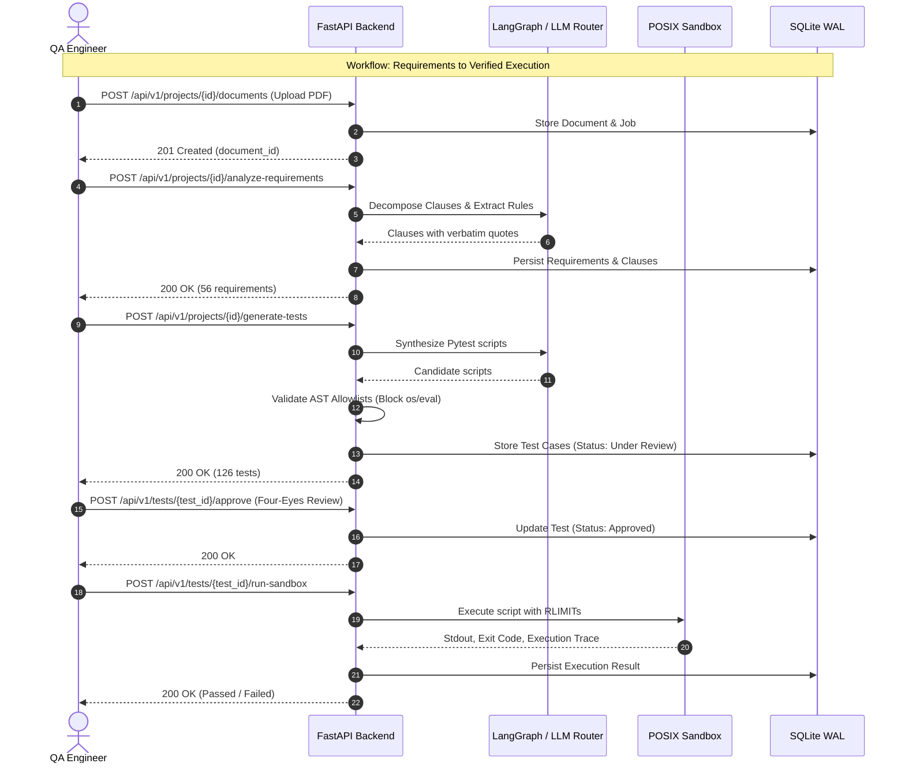

# TraceTest AI — REST API Contract & Specification

## 1. Overview & Protocol Invariants

The **TraceTest AI REST API** provides programmatic access to all workspace management, document extraction, requirements engineering, test generation, sandboxed execution, and defect tracking capabilities.

- **Base URL**: `http://127.0.0.1:8000/api/v1`
- **Default Bind Host**: `127.0.0.1` (Strict loopback isolation)
- **Protocol**: HTTP/1.1 over TCP
- **Payload Format**: `application/json` (UTF-8 encoded)
- **Machine-Readable Companion**: The complete OpenAPI 3.1.0 specification is available at [docs/openapi.json](openapi.json) and interactively at `http://127.0.0.1:8000/api/docs`.

---

## 2. Authentication, Sessions & Security Headers

TraceTest AI supports two primary authentication modes:

### 2.1 Interactive Operator Mode (Browser / SPA)
- **Signed Session Cookie**: On successful authentication via `POST /api/v1/auth/login`, the server mints a cryptographically signed HMAC session cookie named `session_id` (`HttpOnly=True`, `SameSite=Strict`, `Path=/`).
- **CSRF Protection**: The server sets a `csrf_token` cookie. All mutating HTTP methods (`POST`, `PUT`, `PATCH`, `DELETE`) require the `X-CSRF-Token` HTTP header matching the cookie value.
- **Operator Switching**: In local evaluation mode, `POST /api/v1/auth/switch-operator` allows switching active operator roles without password re-entry.

### 2.2 Automated CI/CD & Service Integration
- **Bearer Token**: Machine clients pass an API token in the `Authorization` header:
  ```http
  Authorization: Bearer <TRACETEST_CI_TOKEN>
  ```

### 2.3 Standard Error Format
All 4xx and 5xx responses conform to a unified JSON error structure:

```json
{
  "code": "ENTITY_NOT_FOUND",
  "message": "Project with key 'DAYFORCE' was not found.",
  "details": {
    "project_key": "DAYFORCE"
  },
  "request_id": "req_01h9x37f8k2"
}
```

| HTTP Status | Error Code | Description |
|---|---|---|
| **400 Bad Request** | `INVALID_PAYLOAD` | Request body failed schema validation or contained forbidden syntax. |
| **401 Unauthorized** | `AUTH_REQUIRED` | Missing, invalid, or expired session cookie / bearer token. |
| **403 Forbidden** | `PERMISSION_DENIED` | Action disallowed (e.g. author attempting to self-approve a test case). |
| **404 Not Found** | `ENTITY_NOT_FOUND` | The requested resource (project, requirement, test, execution) does not exist. |
| **422 Unprocessable** | `UNPROCESSABLE_ENTITY` | Pydantic validation failure on field types or constraints. |
| **500 Server Error** | `INTERNAL_ERROR` | Unhandled backend exception; trace logged to server stdout. |

---

## 3. Core Endpoint Groups

### 3.1 Authentication & Session (`/api/v1/auth`)

| Method | Path | Summary | Auth Required |
|---|---|---|:---:|
| `POST` | `/api/v1/auth/login` | Authenticate operator with email and password | No |
| `POST` | `/api/v1/auth/logout` | Terminate session and invalidate cookies | Yes |
| `GET` | `/api/v1/auth/me` | Fetch currently authenticated user profile and roles | Yes |
| `POST` | `/api/v1/auth/switch-operator` | Switch active operator persona for testing | Yes |

#### `POST /api/v1/auth/login`
- **Request Body**:
  ```json
  {
    "email": "operator@tracetest.local",
    "password": "local-dev-password"
  }
  ```
- **Response `200 OK`**:
  ```json
  {
    "user": {
      "id": 1,
      "email": "operator@tracetest.local",
      "full_name": "Primary Operator",
      "roles": ["QA_LEAD", "SYSTEM_ADMIN"]
    },
    "csrf_token": "csrf_ab48f10c7"
  }
  ```

---

### 3.2 Projects & Workspace Management (`/api/v1/projects`)

| Method | Path | Summary | Auth Required |
|---|---|---|:---:|
| `GET` | `/api/v1/projects` | List all projects with summaries and health metrics | Yes |
| `POST` | `/api/v1/projects` | Create a new requirements-based or code-based project | Yes |
| `GET` | `/api/v1/projects/{project_id}` | Retrieve project details, context, and settings | Yes |
| `PATCH` | `/api/v1/projects/{project_id}` | Update project description, status, or settings | Yes |
| `GET` | `/api/v1/projects/{project_id}/dashboard` | Retrieve consolidated project dashboard analytics | Yes |
| `POST` | `/api/v1/projects/import-repo` | Ingest and inspect a remote GitHub repository | Yes |
| `POST` | `/api/v1/projects/{project_id}/refresh-repo` | Pull latest commits and re-parse repository AST | Yes |
| `DELETE` | `/api/v1/projects/{project_id}/disconnect-repo`| Disconnect GitHub integration from project | Yes |

#### `POST /api/v1/projects`
- **Request Body**:
  ```json
  {
    "key": "DAYFORCE",
    "name": "Dayforce HCM",
    "description": "Enterprise HR, workforce, time and payroll platform.",
    "workflow_type": "requirements_based",
    "business_domain": "Human Capital Management"
  }
  ```
- **Response `201 Created`**:
  ```json
  {
    "id": 9,
    "key": "DAYFORCE",
    "name": "Dayforce HCM",
    "status": "ACTIVE",
    "created_at": "2026-11-07T10:00:00Z"
  }
  ```

---

### 3.3 Document Intake & Processing (`/api/v1/documents`)

| Method | Path | Summary | Auth Required |
|---|---|---|:---:|
| `POST` | `/api/v1/projects/{project_id}/documents` | Upload requirement document (PDF, DOCX, XLSX, MD) | Yes |
| `GET` | `/api/v1/projects/{project_id}/documents` | List all uploaded documents for a project | Yes |
| `GET` | `/api/v1/documents/{document_id}` | Retrieve document details and processing status | Yes |
| `POST` | `/api/v1/documents/{document_id}/process` | Trigger asynchronous document content extraction | Yes |
| `GET` | `/api/v1/documents/{document_id}/extracted-content`| Retrieve parsed text blocks and tables | Yes |
| `DELETE` | `/api/v1/documents/{document_id}` | Delete uploaded document and its extracted content | Yes |

---

### 3.4 Requirements & Clauses (`/api/v1/requirements`)

| Method | Path | Summary | Auth Required |
|---|---|---|:---:|
| `GET` | `/api/v1/requirements` | Query requirements across projects with filters | Yes |
| `GET` | `/api/v1/projects/{project_id}/requirements-dashboard`| Get requirements breakdown by category & status | Yes |
| `POST` | `/api/v1/projects/{project_id}/analyze-requirements`| Trigger semantic clause decomposition & ambiguity scan | Yes |
| `GET` | `/api/v1/requirements/{req_id}` | Get requirement details with clauses and criteria | Yes |
| `GET` | `/api/v1/requirements/{req_id}/clauses` | Retrieve atomic numbered clauses with source quotes | Yes |
| `POST` | `/api/v1/requirements/{req_id}/approve` | Approve extracted requirement for test design | Yes |
| `POST` | `/api/v1/requirements/{req_id}/reject` | Reject requirement with feedback comments | Yes |
| `GET` | `/api/v1/projects/{project_id}/clarifications`| List detected ambiguities and contradictions | Yes |
| `POST` | `/api/v1/clarifications/{clarification_id}/resolve`| Record human clarification resolution | Yes |

#### `GET /api/v1/requirements/{req_id}/clauses`
- **Response `200 OK`**:
  ```json
  [
    {
      "id": 142,
      "clause_key": "DAYFORCE-C01",
      "position": 1,
      "text": "Daily overtime must be calculated at 1.5x regular pay after 8 hours worked in a single workday.",
      "source_quote": "Employees shall receive one and one-half times their regular rate of pay for all hours worked in excess of eight hours up to and including 12 hours in any workday.",
      "page_number": 4
    }
  ]
  ```

---

### 3.5 Acceptance Criteria (`/api/v1/acceptance-criteria`)

| Method | Path | Summary | Auth Required |
|---|---|---|:---:|
| `GET` | `/api/v1/projects/{project_id}/acceptance-criteria`| List all Given/When/Then acceptance criteria | Yes |
| `POST` | `/api/v1/projects/{project_id}/generate-acceptance-criteria`| Synthesize criteria from approved clauses | Yes |
| `POST` | `/api/v1/acceptance-criteria/{ac_id}/review`| Record human signoff for an acceptance criterion | Yes |

---

### 3.6 Test Design & Suites (`/api/v1/tests`, `/api/v1/suites`)

| Method | Path | Summary | Auth Required |
|---|---|---|:---:|
| `GET` | `/api/v1/tests` | Query test cases with category and status filters | Yes |
| `POST` | `/api/v1/projects/{project_id}/generate-tests` | Synthesize test cases using LangGraph pipeline | Yes |
| `GET` | `/api/v1/tests/{test_id}` | Retrieve test case specification, steps, and script | Yes |
| `POST` | `/api/v1/tests/{test_id}/validate` | Validate test script against static AST allowlist | Yes |
| `POST` | `/api/v1/tests/{test_id}/approve` | Record dual-control approval (enforcing 4-eyes) | Yes |
| `POST` | `/api/v1/tests/{test_id}/reject` | Reject test case with reviewer notes | Yes |
| `POST` | `/api/v1/tests/bulk-review` | Bulk approve or reject a list of test cases | Yes |
| `GET` | `/api/v1/suites` | List configured test suites for a project | Yes |
| `POST` | `/api/v1/suites` | Create a new test suite | Yes |

---

### 3.7 Test Executions & Sandboxing (`/api/v1/executions`)

| Method | Path | Summary | Auth Required |
|---|---|---|:---:|
| `GET` | `/api/v1/executions` | List execution runs with duration and pass/fail counts | Yes |
| `POST` | `/api/v1/suites/{suite_id}/execute` | Launch test execution inside POSIX sandbox | Yes |
| `POST` | `/api/v1/tests/{test_id}/run-sandbox` | Execute single test script directly in sandbox | Yes |
| `GET` | `/api/v1/executions/{ex_id}` | Retrieve execution run status, metrics, and results | Yes |
| `GET` | `/api/v1/executions/{ex_id}/logs` | Stream stdout/stderr execution output | Yes |
| `GET` | `/api/v1/executions/{ex_id}/report.junit` | Download JUnit XML test report | Yes |
| `GET` | `/api/v1/executions/{ex_id}/report.html` | Download interactive HTML execution report | Yes |
| `POST` | `/api/v1/executions/{ex_id}/cancel` | Abort a running execution subprocess | Yes |

---

### 3.8 Defect Management (`/api/v1/defects`)

| Method | Path | Summary | Auth Required |
|---|---|---|:---:|
| `GET` | `/api/v1/defects` | List defects with severity, status, and linked tests | Yes |
| `POST` | `/api/v1/defects` | Log a defect manually or from an execution failure | Yes |
| `GET` | `/api/v1/defects/{defect_id}` | Retrieve defect details, reproduction script, logs | Yes |
| `PATCH` | `/api/v1/defects/{defect_id}` | Update defect severity, status, or assignee | Yes |
| `POST` | `/api/v1/defects/{defect_id}/retest` | Re-run linked test case in sandbox to verify fix | Yes |
| `POST` | `/api/v1/defects/{defect_id}/github-issue` | Create and synchronize linked GitHub Issue | Yes |

---

### 3.9 Simulation & Behavioral Engine (`/api/v1/simulation`)

| Method | Path | Summary | Auth Required |
|---|---|---|:---:|
| `POST` | `/api/v1/projects/{project_id}/run-simulation` | Execute business rule simulation scenarios | Yes |
| `POST` | `/api/v1/simulation/ingest-policy` | Ingest YAML declarative policy rules | Yes |
| `GET` | `/api/v1/simulation/golden-policies` | Retrieve reference golden test policies | Yes |
| `GET` | `/api/v1/simulation/agent-traces` | Inspect agent decision traces and LLM token usage | Yes |

---

### 3.10 Quality Analytics & Traceability (`/api/v1/analytics`, `/api/v1/traceability`)

| Method | Path | Summary | Auth Required |
|---|---|---|:---:|
| `GET` | `/api/v1/analytics/dashboard` | Global quality analytics and coverage metrics | Yes |
| `GET` | `/api/v1/projects/{project_id}/traceability` | Retrieve requirement-to-test traceability matrix | Yes |
| `GET` | `/api/v1/traceability/matrix` | Full bidirectional cross-project traceability matrix | Yes |
| `GET` | `/api/v1/projects/{project_id}/quality-report` | Comprehensive quality evaluation scorecards | Yes |

---

### 3.11 External Integrations & GitHub (`/api/v1/integrations`)

| Method | Path | Summary | Auth Required |
|---|---|---|:---:|
| `GET` | `/api/v1/integrations` | List configured external service integrations | Yes |
| `GET` | `/api/v1/integrations/github/{project_id}/branches`| List remote branches for connected repository | Yes |
| `POST` | `/api/v1/integrations/github/{project_id}/export-tests`| Export approved test suites back to GitHub repo | Yes |

---

### 3.12 Audit, System & Administration (`/api/v1/audit`, `/api/v1/health`)

| Method | Path | Summary | Auth Required |
|---|---|---|:---:|
| `GET` | `/api/v1/health` | Service health status, database ping, uptime | No |
| `GET` | `/api/v1/audit` | Query immutable audit log with filters | Yes |
| `GET` | `/api/v1/notifications` | List notifications for the authenticated user | Yes |
| `POST` | `/api/v1/admin/backup` | Trigger an immediate SQLite database snapshot backup | Yes |

---

## 4. Primary API Workflows


