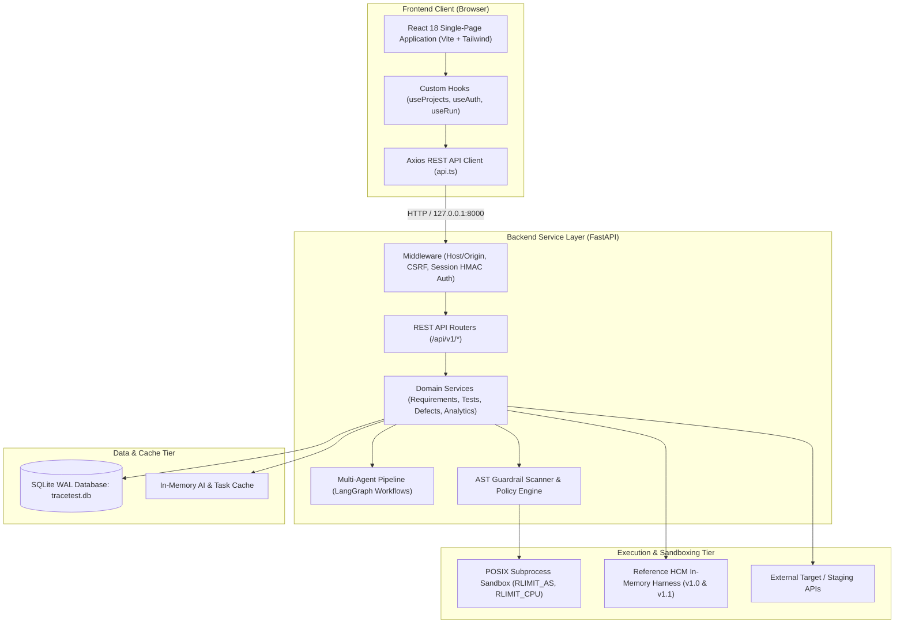
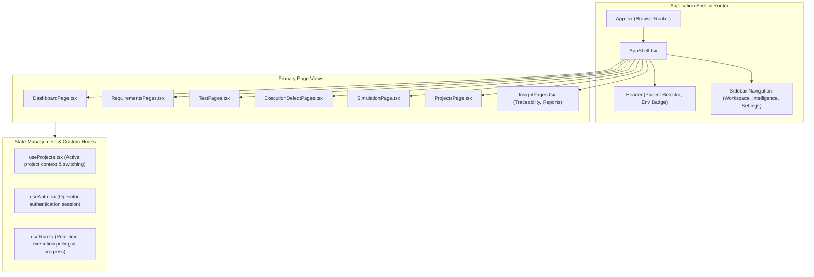
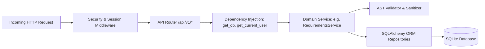
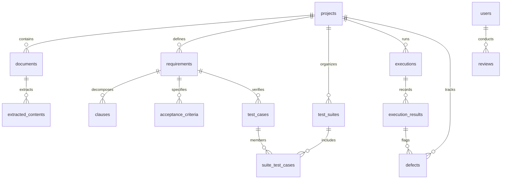
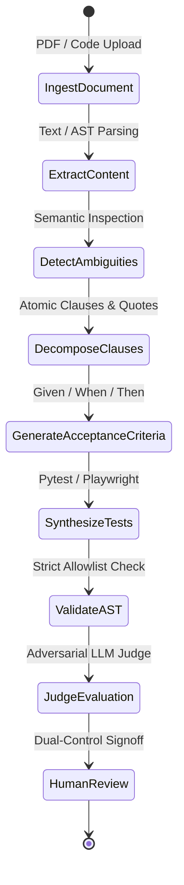

# TraceTest AI — System Architecture & Engineering Blueprint

## 1. Architectural Overview & System Design

**TraceTest AI** is an enterprise-grade quality engineering platform structured as a decoupled, multi-tiered application:
- **Presentation Tier**: Modern React 18 single-page application built with Vite, TypeScript, and Tailwind CSS.
- **Service Tier**: High-performance FastAPI asynchronous backend organized around modular domain services, LangGraph multi-agent pipelines, and deterministic AST validators.
- **Data Tier**: SQLite database with Write-Ahead Logging (WAL), foreign key enforcement, and automated database migrations managed via Alembic and SQLAlchemy.
- **Execution & Security Tier**: Multi-layer execution sandboxes combining POSIX resource limits (`RLIMIT_*`), Linux namespaces/bubblewrap containerization, in-memory reference harnesses, and static AST allowlist scanners.



---

## 2. Repository Structure

The actual file and directory layout of the TraceTest AI repository is organized as follows:

```text
tracetest-ai/
├── .github/
│   └── workflows/
│       ├── benchmark.yml             # LLM provider latency & quality benchmarks
│       └── ci.yml                   # CI pipeline (lint, typecheck, pytest, vitest, docs)
├── backend/
│   ├── alembic.ini                  # Alembic migration configuration
│   ├── pyproject.toml               # Python project configuration (Ruff, pytest)
│   ├── pytest.ini                   # Pytest execution configuration
│   ├── requirements.txt             # Production runtime dependencies
│   ├── requirements-dev.txt         # Development and testing dependencies
│   ├── app/
│   │   ├── main.py                  # FastAPI application entrypoint & lifespan
│   │   ├── api/                     # REST API routers, dependencies, and serializers
│   │   ├── core/                    # App configuration, security, session auth, errors
│   │   ├── db/                      # SQLAlchemy models, init_db, and maintenance
│   │   ├── domain/                  # Enums and core domain constants
│   │   ├── execution/               # POSIX sandbox, bwrap/netns isolation
│   │   ├── graph/                   # LangGraph requirement and execution workflows
│   │   ├── guardrails/              # AST validators, ambiguity, clause, quote checks
│   │   ├── integrations/            # GitHub client and external repository services
│   │   ├── llm/                     # Router, providers (Gemini, Groq), judge, mock fixtures
│   │   ├── seed/                    # Database seeding and default project datasets
│   │   └── services/                # Business logic for requirements, tests, defects, etc.
│   ├── evals/                       # Evaluation scenarios and golden test sets
│   ├── migrations/                  # Alembic migration versions (0001 - 0006)
│   └── tests/                       # 216+ backend unit, contract, AST, and E2E tests
├── data/
│   ├── dayforce_sample_docs/        # Dayforce sample requirements (PRD, SRS, Excel)
│   └── wfmq_sample_docs/            # WFMQ sample statutory policies and rules
├── docs/                            # Authoritative project documentation and reports
├── echobox_harness/                 # In-memory mock AWS serverless backend harness
├── frontend/
│   ├── index.html                   # Single-page application root
│   ├── package.json                 # Node dependencies (React 18, Vite, Lucide, Tailwind)
│   ├── tailwind.config.js           # Design tokens, color palette, and spacing scales
│   ├── tsconfig.json                # TypeScript compiler configuration
│   ├── vite.config.ts               # Vite bundler configuration and proxy
│   ├── src/
│   │   ├── App.tsx                  # Root routing and application providers
│   │   ├── components/              # Shared UI components (DataTable, Toast, ErrorBoundary)
│   │   ├── hooks/                   # Custom hooks (useProjects, useAuth, useRun)
│   │   ├── layouts/                 # AppShell layout with Header and Sidebar navigation
│   │   ├── pages/                   # Feature views (Dashboard, Requirements, Tests, Runs)
│   │   ├── services/                # Axios API client (api.ts)
│   │   └── types/                   # TypeScript interfaces and generated API types
│   └── tests/                       # 21 Vitest frontend component and integration tests
├── reference_hcm/
│   ├── v1_0/                        # Reference HCM engine with 8 deliberate statutory faults
│   └── v1_1/                        # Remediated Reference HCM engine (green baseline)
└── scripts/
    ├── bootstrap_env.py             # Environment configuration generator
    ├── db.py                        # Database migration and inspection utility
    ├── export_openapi.py            # OpenAPI JSON exporter
    └── verify_docs.py               # Documentation and security invariant test suite
```

---

## 3. Frontend Architecture

The frontend is implemented as a high-performance React 18 application built with TypeScript, Tailwind CSS, and Vite.



### 3.1 Component Architecture & Routing
- **`App.tsx`**: Sets up React Router DOM, handles top-level routing, and wraps pages with context providers.
- **`AppShell.tsx`**: Provides the structural layout including the collapsible sidebar navigation, top application header with active project selector, breadcrumbs, search input, and notifications.
- **`DashboardPage.tsx`**: Renders project health metrics, processing progress bars, quick actions, and recent activity. Adapts automatically to Requirements-Based vs. Code-Based workflows.
- **`RequirementsPages.tsx`**: Tabbed interface featuring Document Intake, Extracted Content, Requirements List, Given/When/Then criteria, and Ambiguity Cards.
- **`TestPages.tsx`**: Displays test case catalog with status filters (Approved, Under Review, Deprecated), category badges, and side detail drawers for preconditions and steps.
- **`ExecutionDefectPages.tsx`**: Manages execution runs, JUnit XML result viewers, failure tracebacks, defect lifecycles, and retest triggers.

### 3.2 State Management & Network Layer
- **`useProjects.tsx`**: Manages the global active project state (`activeProject`), loads available workspaces from `/api/v1/projects`, and syncs project switching across all views.
- **`useAuth.tsx`**: Tracks the authenticated operator session, handling CSRF token exchange and user role switches.
- **`api.ts`**: Centralized Axios client configured with credentials support (`withCredentials: true`), CSRF request interceptors (`X-CSRF-Token`), and unified error handling.

---

## 4. Backend Architecture

The backend is built using FastAPI and Python 3.11+, following a modular, layered service-oriented architecture:



### 4.1 Layered Architecture
1. **API Layer (`app/api/`)**: Defines REST routers, path parameters, query validators, and request/response serializers using Pydantic models.
2. **Core Layer (`app/core/`)**: Houses application configuration (`config.py`), cryptographic utilities, Argon2 password hashing, signed session cookie handlers, and global exception handlers.
3. **Database Layer (`app/db/`)**: Defines all 44 SQLAlchemy ORM models, session factories, transaction managers, and SQLite initialization scripts.
4. **Services Layer (`app/services/`)**: Contains pure business logic decoupled from HTTP frameworks, including document processing, AST parsing, test generation, defect management, and analytics.
5. **Execution Layer (`app/execution/`)**: Handles isolated test execution inside subprocess sandboxes with POSIX resource limits and output streaming.
6. **Integrations Layer (`app/integrations/`)**: Manages external GitHub repository cloning, branch listing, and issue creation.

### 4.2 Application Lifespan & Middleware Stack
FastAPI's `@asynccontextmanager` initializes SQLite WAL pragmas, verifies database connectivity, and ensures background task pools are ready. The middleware pipeline enforces:
- **Host & Origin Validation**: Restricts accepted HTTP `Host` headers to loopback interfaces.
- **Session Authentication**: Mints and validates cryptographically signed HMAC session cookies (`SameSite=Strict`, `HttpOnly=True`).
- **CSRF Protection**: Enforces double-submit CSRF cookie checks for all state-mutating requests (`POST`, `PUT`, `PATCH`, `DELETE`).

---

## 5. Database Architecture & Schema Specification

TraceTest AI uses SQLite with Write-Ahead Logging (`PRAGMA journal_mode=WAL;`), foreign key constraints (`PRAGMA foreign_keys=ON;`), and busy timeouts (`PRAGMA busy_timeout=5000;`). The database comprises **44 SQLAlchemy models** structured into 8 functional clusters:



### Complete Model Catalog (All 44 Tables)

Below is the exhaustive documentation of all 44 SQLAlchemy database tables:

1. **`organisations`**: Multi-tenant organization containers (`id`, `name`, `slug`, `created_at`).
2. **`users`**: System operators and engineers (`id`, `email`, `full_name`, `title`, `password_hash`, `is_active`).
3. **`roles`**: Global system authorization roles (`id`, `name`, `description`).
4. **`user_roles`**: Many-to-many user-role association mappings (`id`, `user_id`, `role_id`).
5. **`sessions`**: Authenticated operator sessions (`id`, `token_hash`, `csrf_token`, `user_id`, `created_at`, `expires_at`).
6. **`login_attempts`**: Audit trail of authentication attempts (`id`, `email`, `ip`, `success`, `created_at`).
7. **`projects`**: Core project entities (`id`, `key`, `name`, `description`, `status`, `workflow_type`, `repository_url`, `created_at`).
8. **`project_contexts`**: Domain metadata and product context (`id`, `project_id`, `product_overview`, `problem_statement`, `target_users`).
9. **`project_roles`**: Granular per-project role definitions (`id`, `project_id`, `role_name`, `description`, `permissions`).
10. **`project_members`**: User memberships within projects (`id`, `project_id`, `user_id`, `project_role`, `added_at`).
11. **`modules`**: Logical system modules and packages (`id`, `project_id`, `code`, `name`, `description`).
12. **`environments`**: Target execution environments (`id`, `project_id`, `name`, `kind`, `hcm_version`, `base_url`).
13. **`documents`**: Ingested requirement documents (`id`, `project_id`, `filename`, `display_name`, `file_path`, `mime_type`, `doc_type`, `file_hash`, `page_count`, `processing_status`).
14. **`document_processing_jobs`**: Asynchronous document extraction status (`id`, `document_id`, `project_id`, `job_status`, `processing_stage`, `error_message`).
15. **`extracted_contents`**: Extracted text, tables, and images (`id`, `document_id`, `content_type`, `content`, `source_page`, `character_count`).
16. **`requirements`**: Extracted functional and statutory requirements (`id`, `key`, `project_id`, `module_id`, `document_id`, `title`, `description`, `category`, `status`, `version`).
17. **`requirement_versions`**: Historical versions of requirements (`id`, `requirement_id`, `version`, `title`, `description`, `created_by`, `created_at`).
18. **`clauses`**: Atomic numbered clauses with verbatim quotes (`id`, `version_id`, `requirement_id`, `clause_key`, `position`, `text`, `source_quote`, `page_number`).
19. **`acceptance_criteria`**: Given/When/Then criteria (`id`, `key`, `requirement_id`, `requirement_version`, `clause_keys`, `given_text`, `when_text`, `then_text`, `status`).
20. **`requirement_clarifications`**: Ambiguities and contradictions flagged for review (`id`, `project_id`, `requirement_id`, `type`, `question`, `proposed_resolution`, `status`).
21. **`business_scenarios`**: High-level end-to-end operational scenarios (`id`, `project_id`, `title`, `description`, `actor`, `flow_type`).
22. **`simulation_models`**: Declarative simulation specifications (`id`, `project_id`, `name`, `version`, `domain`, `rules_schema`).
23. **`test_cases`**: Verifiable test specifications and scripts (`id`, `key`, `project_id`, `requirement_id`, `requirement_version`, `title`, `category`, `priority`, `status`, `script_content`, `script_hash`, `ast_validated`).
24. **`test_case_versions`**: Immutable snapshots of test cases (`id`, `test_case_id`, `version`, `snapshot`, `script_hash`, `created_at`).
25. **`test_steps`**: Granular operational test steps (`id`, `test_case_id`, `position`, `action`, `expected`, `test_data`).
26. **`test_suites`**: Logical groupings of test cases (`id`, `key`, `project_id`, `module_id`, `name`, `description`).
27. **`suite_test_cases`**: Association between test suites and test cases (`id`, `suite_id`, `test_case_id`, `position`).
28. **`reviews`**: Dual-control review and approval records (`id`, `entity_type`, `entity_id`, `entity_version`, `decision`, `reviewer_id`, `comments`, `created_at`).
29. **`runs`**: Generic pipeline and workflow run tracker (`id`, `kind`, `status`, `subject_type`, `subject_id`, `created_at`).
30. **`run_steps`**: Individual stages executed within a run (`id`, `run_id`, `name`, `status`, `detail`, `started_at`, `ended_at`).
31. **`executions`**: Test suite execution records (`id`, `key`, `project_id`, `suite_id`, `environment_id`, `status`, `total_tests`, `passed_tests`, `failed_tests`, `blocked_tests`, `duration_ms`).
32. **`execution_results`**: Test case outcome per execution run (`id`, `execution_id`, `test_case_id`, `test_case_version`, `script_hash`, `status`, `stdout`, `stderr`, `traceback`, `duration_ms`).
33. **`execution_artifacts`**: Artifacts captured during execution (`id`, `execution_id`, `result_id`, `kind`, `path`, `mime_type`).
34. **`defects`**: Tracked bugs and discrepancies (`id`, `key`, `project_id`, `title`, `description`, `severity`, `status`, `test_case_id`, `execution_id`, `github_issue_id`, `github_issue_url`).
35. **`defect_comments`**: Collaboration and triage discussions (`id`, `defect_id`, `author_id`, `body`, `created_at`).
36. **`defect_links`**: Cross-links between related defects (`id`, `defect_id`, `related_defect_id`, `link_type`).
37. **`integrations`**: External service configurations (`id`, `project_id`, `kind`, `config`, `status`, `last_synced_at`).
38. **`integration_events`**: History of integration synchronization webhooks (`id`, `integration_id`, `kind`, `status`, `request_summary`).
39. **`audit_log`**: Tamper-evident immutable audit log (`id`, `actor_id`, `action`, `entity_type`, `entity_id`, `before_state`, `after_state`, `ip_address`, `created_at`).
40. **`notifications`**: User alerts and notifications (`id`, `user_id`, `title`, `body`, `link`, `is_read`, `created_at`).
41. **`ai_cache`**: Idempotent LLM completion response cache (`id`, `prompt_hash`, `task`, `provider`, `model`, `response_content`, `created_at`).
42. **`eval_runs`**: Benchmark evaluation runs (`id`, `provider`, `model`, `is_fixture`, `status`, `scenario_count`, `pass_rate`).
43. **`eval_results`**: Per-scenario evaluation outcomes (`id`, `eval_run_id`, `scenario_key`, `passed`, `metrics`).
44. **`provider_traces`**: Token usage, latency, and telemetry per LLM call (`id`, `run_id`, `provider`, `model`, `slot_id`, `prompt_tokens`, `completion_tokens`, `duration_ms`).

---

## 6. AI & Multi-Agent Pipeline Architecture

TraceTest AI orchestrates multi-agent tasks using LangGraph workflows, providing stateful execution graphs with checkpointing and retry logic:



### 6.1 Multi-Key Provider Router & Failover
The platform features an intelligent LLM router (`app/llm/router.py`) supporting:
- **Provider Multi-Tenancy**: Load balances between Google Gemini and Groq (Llama 3.3 70B).
- **Key Rotation**: Rotates through API key pools to bypass per-minute rate limits.
- **Circuit Breaking & Cooldown**: Automatically marks rate-limited keys as cooling down (default 60s) and routes to active slots.
- **Deterministic Mock Fallback**: When external LLM APIs are unavailable or offline, the system falls back seamlessly to deterministic rule-based fixtures (`app/llm/mock_fixtures.py`), ensuring 100% test suite and platform operability.

### 6.2 Adversarial LLM-as-a-Judge
During test generation, an independent judge model (`app/llm/judge.py`) evaluates the synthesized test against the source requirement clause:
- **Statutory Grounding Score (0-100%)**: Measures how closely assertions align with legal or contract rules.
- **Verbatim Quote Fidelity**: Verifies that cited text exists identically in source documents.
- **Safety Score**: Confirms absence of hallucinated interfaces.

---

## 7. Execution Architecture & Sandboxing

TraceTest AI implements defense-in-depth sandboxing to execute test scripts securely:

| Sandboxing Level | Technology | Isolation Mechanism | Use Case |
|---|---|---|---|
| **Level 1: Static AST Allowlist** | Python `ast` module | Pre-execution AST parsing rejecting banned nodes (`Call` to `eval`, `Import` of `os`, `sys`, `socket`) | All generated test scripts |
| **Level 2: POSIX Limits** | Linux `setrlimit` | Restricts CPU time (30s), Address Space (512MB), open files (256), processes (64) | Subprocess execution |
| **Level 3: Linux Namespaces** | `bwrap` / `unshare` | Network namespace isolation (`--unshare-net`), read-only root bind mounts | Production Linux hosts |
| **Level 4: In-Memory Harness** | Python runtime | Pure in-memory stateful contracts (Reference HCM) with zero filesystem or network I/O | Fast statutory regression |

---

## 8. Architecture Decision Records (ADRs) Summary

| ADR ID | Decision Title | Status | Rationale |
|---|---|---|---|
| **ADR-001** | SQLite with WAL Mode | Accepted | Delivers high read concurrency, zero external database setup for evaluators, and transaction reliability. |
| **ADR-002** | Strict Loopback Binding (`127.0.0.1`) | Accepted | Prevents accidental network exposure of local operator environments on shared machines. |
| **ADR-003** | Four-Eyes Governance for Tests | Accepted | Enforces regulatory compliance by prohibiting automated self-approval of generated verification scripts. |
| **ADR-004** | Static AST Allowlisting | Accepted | Completely neutralizes remote code execution and prompt injection before scripts reach subprocess runners. |
| **ADR-005** | LangGraph for Pipeline Orchestration | Accepted | Provides explicit DAG execution graphs, checkpointing, and inspectable state transitions. |
| **ADR-006** | Deterministic Mock Fixture Fallbacks | Accepted | Guarantees the application runs cleanly on fresh clones without external internet connectivity or paid API keys. |
| **ADR-007** | Verbatim Source Quote Requirement | Accepted | Eliminates hallucinations by requiring every extracted clause to link to identical document source text. |
| **ADR-008** | Multi-Tier Test Execution Hierarchy | Accepted | Separates fast in-memory validation from sandboxed subprocess runs and live staging tests. |
| **ADR-009** | Double-Submit CSRF with HMAC Sessions | Accepted | Eliminates CSRF vulnerabilities and insecure basic auth across frontend single-page operations. |
| **ADR-010** | Standalone JSON Seed Catalogues | Accepted | Enables instant project recovery and fresh-clone persistence for Dayforce, EchoBox, Cureonix, and WFMQ. |
| **ADR-011** | Decoupled UI State Management | Accepted | Separates global active project routing from page-level query caching for instant project switching. |
| **ADR-012** | Reference HCM Dual-Version Architecture | Accepted | Preserves Reference HCM v1.0 with 8 deliberate faults alongside v1.1 green baseline to evaluate test accuracy. |

