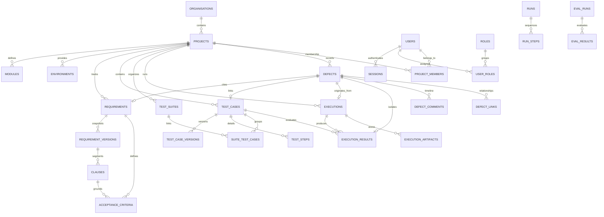

# Database Schema & Entity Relationships — TraceTest AI

## 1. Overview

TraceTest AI uses SQLite 3 operating with Write-Ahead Logging (`WAL`), immediate transaction locks, strict foreign key constraints, and 64-bit integer primary keys managed through SQLAlchemy 2.0 ORM. All 39 database tables are fully normalized, indexed for high-concurrency read operations, and audited with append-only logs.

---

## 2. Entity-Relationship Diagram



---

## 3. Comprehensive 36-Table Specification

### 3.1 Organization & Identity Domain
1. **`organisations`**: Top-level tenant container (`id`, `name`, `created_at`, `updated_at`).
2. **`users`**: User identity accounts (`id`, `email`, `full_name`, `password_hash`, `is_active`, `can_login`, `last_login_at`).
3. **`roles`**: System roles (`id`, `name` ∈ `admin`, `qa_engineer`, `reviewer`, `description`).
4. **`user_roles`**: Many-to-many role assignments (`id`, `user_id`, `role_id`).
5. **`project_members`**: Tenancy membership controlling project access (`id`, `project_id`, `user_id`, `project_role`).
6. **`sessions`**: Cryptographically signed user sessions (`id`, `token_hash`, `csrf_token`, `user_id`, `ip`, `expires_at`, `revoked`).
7. **`login_attempts`**: Rate limiting and brute-force protection ledger (`id`, `email`, `ip`, `success`, `created_at`).
8. **`notifications`**: User alerts and notifications (`id`, `user_id`, `title`, `body`, `link`, `read`, `created_at`).

### 3.2 Projects & Environment Domain
9. **`projects`**: Project workspaces (`id`, `key`, `name`, `description`, `status`, `project_type`, `business_domain`, `product_type`, `target_users_and_roles`, `objectives`, `business_scenarios`, `functional_expectations`, `non_functional_expectations`, `constraints_and_assumptions`, `explicit_exclusions`, `organisation_id`, `owner_id`).
10. **`modules`**: Functional domain areas (`id`, `project_id`, `code`, `name`, `description`).
11. **`environments`**: Target systems under test (`id`, `project_id`, `name`, `kind`, `base_url`, `hcm_version`, `is_default`).
12. **`documents`**: Ingested product & specification documents (`id`, `project_id`, `filename`, `file_path`, `file_type`, `file_size_bytes`, `purpose`, `description`, `status`, `error_message`, `extracted_text`, `metadata_json`, `created_at`, `updated_at`).
13. **`simulation_models`**: Behavior simulation models (`id`, `project_id`, `name`, `version`, `domain`, `definition_json`, `status`, `created_at`, `updated_at`).
14. **`integrations`**: External connectors e.g. GitHub (`id`, `project_id`, `kind`, `status`, `config`, `created_at`).
15. **`integration_events`**: Audit trail of incoming webhooks and sync events (`id`, `integration_id`, `event_type`, `payload`, `created_at`).

### 3.3 Requirements Engineering Domain
16. **`requirements`**: Master requirement records (`id`, `key`, `project_id`, `module_id`, `document_id`, `title`, `category`, `priority`, `status`, `origin`, `source_commit_sha`, `source_section`, `source_page`, `evidence_excerpt`, `related_scenario`, `dependencies`, `extraction_provenance`, `review_status`, `confidence`, `current_version`).
17. **`requirement_versions`**: Immutable requirement snapshots (`id`, `requirement_id`, `version`, `title`, `description`, `business_objective`, `content_hash`, `change_summary`).
18. **`clauses`**: Atomic segmented clauses (`id`, `version_id`, `requirement_id`, `clause_key`, `position`, `text`, `source_paths`, `source_line_start`, `source_line_end`, `normalized_hash`, `ambiguity_flags`, `analysis`).
19. **`requirement_clarifications`**: Ambiguities, contradictions, and question items (`id`, `project_id`, `requirement_id`, `type`, `question`, `context`, `impact`, `suggested_resolution`, `user_response`, `status`, `created_at`, `resolved_at`).
20. **`acceptance_criteria`**: Grounded verification criteria (`id`, `key`, `requirement_id`, `requirement_version`, `clause_keys`, `description`, `preconditions`, `expected_behaviour`, `actor`, `action`, `input_conditions`, `expected_output`, `business_rules`, `source_quote`, `quote_verified`, `confidence`, `review_status`).
21. **`reviews`**: Dual-control approval decisions (`id`, `subject_type`, `subject_id`, `reviewer_id`, `decision`, `comment`, `created_at`).

### 3.4 Test Management Domain
19. **`test_cases`**: Test specifications (`id`, `key`, `project_id`, `requirement_id`, `requirement_version`, `clause_keys`, `ac_keys`, `title`, `description`, `priority`, `test_type`, `confidence`, `source_quote`, `quote_verified`, `automation`, `script`, `script_hash`, `validation_status`, `version`, `status`).
20. **`test_case_versions`**: Immutable audit history of test scripts (`id`, `test_case_id`, `version`, `script`, `script_hash`, `status`, `change_summary`).
21. **`test_steps`**: Ordered discrete test steps (`id`, `test_case_id`, `position`, `action`, `expected`, `data`).
22. **`test_suites`**: Batch test groupings (`id`, `project_id`, `name`, `description`, `created_by`, `created_at`).
23. **`suite_test_cases`**: Test suite membership join table (`id`, `suite_id`, `test_case_id`, `position`).

### 3.5 Execution & Artifacts Domain
24. **`executions`**: Test execution runs (`id`, `key`, `project_id`, `suite_id`, `environment_id`, `run_id`, `source`, `runner`, `isolation_level`, `status`, `total`, `passed`, `failed`, `errored`, `duration_ms`, `commit_sha`, `branch`, `log_excerpt`).
25. **`execution_results`**: Individual test case outcomes (`id`, `execution_id`, `test_case_id`, `test_key`, `test_title`, `status`, `duration_ms`, `message`, `stack_trace`, `stdout`, `failure_analysis`).
26. **`execution_artifacts`**: Persisted file artifacts e.g. JUnit XML, Playwright screenshots (`id`, `execution_id`, `kind`, `name`, `path`, `size_bytes`, `sha256`).

### 3.6 Defect & Quality Management Domain
27. **`defects`**: Quality discrepancies (`id`, `key`, `project_id`, `title`, `description`, `severity`, `priority`, `status`, `approval_status`, `evidence_type`, `source_commit_sha`, `expected_result`, `actual_result`, `reproduction_steps`, `error_log`, `ai_analysis`).
28. **`defect_comments`**: Timeline comments on defect records (`id`, `defect_id`, `author_id`, `body`, `created_at`).
29. **`defect_links`**: Cross-defect relationship links (`id`, `defect_id`, `target_defect_id`, `link_type`).

### 3.7 Background Workflow & System Tasks Domain
30. **`runs`**: Background task runs (`id`, `kind`, `status`, `subject_type`, `subject_id`, `thread_id`, `progress`, `message`, `result`, `error`).
31. **`run_steps`**: Granular steps of a background workflow (`id`, `run_id`, `name`, `status`, `detail`, `started_at`, `finished_at`).
32. **`audit_log`**: Append-only tamper-evident audit ledger (`id`, `actor_id`, `action`, `entity_type`, `entity_id`, `project_id`, `trace_id`, `payload`, `source`, `created_at`).

### 3.8 AI Caching, Telemetry & Evaluations Domain
33. **`ai_cache`**: Content-addressed cache for LLM completions (`id`, `prompt_hash`, `task`, `provider`, `model`, `response`, `created_at`).
34. **`provider_traces`**: Observability traces for LLM interactions (`id`, `run_id`, `provider`, `model`, `task`, `prompt_hash`, `status`, `latency_ms`, `attempt`, `input_tokens`, `output_tokens`, `error`, `response_text`).
35. **`eval_runs`**: AI evaluation experiment runs (`id`, `suite_name`, `provider`, `model`, `status`, `scenario_count`, `metrics`, `error`).
36. **`eval_results`**: Granular scenario evaluation results (`id`, `run_id`, `scenario_key`, `status`, `clause_coverage`, `ungrounded_rate`, `duplicate_rate`, `schema_pass`, `metrics`).

---

## 4. SQLite Pragmas & Concurrency Tuning

Applied on connection initialization (`app/db/base.py`):
```sql
PRAGMA foreign_keys = ON;
PRAGMA journal_mode = WAL;
PRAGMA synchronous = NORMAL;
PRAGMA busy_timeout = 10000;
```
Ensures zero lock contention during concurrent test executions, multi-threaded background workers, and audit logging.
