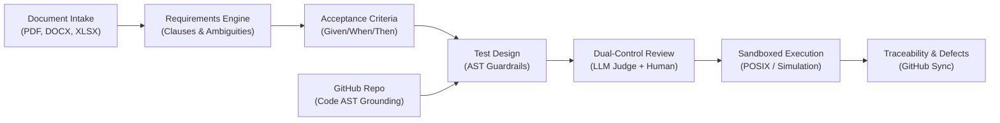

# TraceTest AI — Product Overview

## 1. Project Introduction & Objectives

**TraceTest AI** is an enterprise-grade AI software quality engineering and requirement verification platform. Designed for mission-critical software systems—spanning enterprise Human Capital Management (Dayforce HCM) and modern cloud-native serverless architectures (EchoBox)—TraceTest AI bridges the disconnect between unstructured business requirements, code implementations, automated test suites, and defect remediation.

Unlike prototype dashboards that rely on mock assertions, simulated successes, or ungrounded synthetic metrics, TraceTest AI operates as an **evidence-based verification harness**. It parses actual source code ASTs, ingests real business requirements documents, decomposes specifications into atomic verifiable clauses, synthesizes executable test scripts guarded by AST allowlists, enforces dual-control human governance, and captures empirical proof from sandboxed test executions.

### Core Objectives
1. **Eliminate LLM Hallucinations in Test Generation**: Anchor test cases to verbatim requirement clauses and code AST declarations, disallowing fabricated endpoints or invalid business assumptions.
2. **Deterministic Statutory & Policy Verification**: Translate complex legislative and contractual requirements (such as California Labor Code § 510, FLSA § 7(a), and healthcare HIPAA regulations) into deterministic assertions and edge-case matrices.
3. **End-to-End Bidirectional Traceability**: Maintain a live, unbroken traceability chain linking source documents to atomic clauses, acceptance criteria, test cases, execution runs, and defect reports.
4. **Defense-in-Depth Execution Security**: Run generated test scripts inside resource-restricted POSIX sandboxes with network isolation and AST security scanners to prevent execution of hostile code.
5. **Dual-Control Governance (Four-Eyes Principle)**: Prevent authors from self-approving generated test cases, enforcing independent human review augmented by adversarial AI judge evaluation.

---

## 2. Problem Statement

Enterprise quality engineering faces fundamental challenges in modern distributed and heavily regulated environments:

1. **Hallucinated Assertions & Drift**: Generic LLM test generators frequently hallucinate statutory thresholds, assume non-existent API parameters, or generate trivial "happy path" checks that pass even when the underlying software violates specifications.
2. **Opaque Code & Security Hazards**: AI-generated test scripts often introduce dangerous system calls (`eval`, `subprocess`, socket operations, file system modifications) or fail silently when encountering unexpected network states.
3. **The Audit-Compliance Disconnect**: Compliance auditors and business analysts cannot inspect complex programming language test suites, while software engineers struggle to translate 50-page legal or contractual specifications into comprehensive test coverage.
4. **Fragmented Tooling & Metric Theater**: Engineering teams juggle disconnected tools for requirement tracking, test management, CI execution, and bug tracking. Prototype tools often present "100% green" metrics by omitting boundary conditions or masking failed cloud endpoints.

TraceTest AI solves these challenges by combining deterministic AST code parsing, natural language requirement decomposition, sandboxed execution, and live traceability.

---

## 3. Core Product Capabilities

### 3.1 Multi-Repository GitHub Ingestion & AST Grounding
TraceTest AI dynamically clones and parses remote GitHub repositories. It uses Python and TypeScript Abstract Syntax Tree (AST) parsers to extract routes, handler functions, data models, and architectural dependencies directly from code. This ensures all generated test cases reflect actual codebase interfaces.

### 3.2 Requirements Intelligence & Clause Decomposition
The platform ingests multi-format documents (PDF, DOCX, XLSX, Markdown, TXT) and decomposes them into atomic, numbered clauses. Each clause maintains an exact verbatim quote and page reference to its source document, establishing an immutable provenance ledger.

### 3.3 Ambiguity & Contradiction Detection
An automated semantic analysis engine scans extracted requirements for vague language ("reasonable time", "as appropriate", "sufficient"), undefined terms, and conflicting threshold values across overlapping documents, flagging them for human clarification before test generation begins.

### 3.4 Acceptance Criteria Synthesis (Given/When/Then)
TraceTest AI generates formal Gherkin-style Given/When/Then acceptance criteria linked directly to numbered clauses. Every acceptance criterion maps to specific operational preconditions, actor actions, and deterministic expected outcomes.

### 3.5 Guardrailed Test Generation
The platform synthesizes executable Python `pytest` and Playwright test scripts, as well as declarative YAML simulation policies. Every generated script must pass an AST allowlist scanner that bans dangerous modules (`os`, `sys`, `subprocess`, `socket`, `eval`, `exec`) before it can be stored or reviewed.

### 3.6 Dual-Control Review & LLM-as-a-Judge Governance
Enforcing enterprise **Four-Eyes Principle** governance, test authors cannot approve their own generated scripts. An adversarial LLM Judge evaluates each test for statutory grounding, verbatim quote fidelity, and logical consistency, providing reviewers with automated scorecards and review recommendations.

### 3.7 Multi-Tier Sandboxed Execution
TraceTest AI executes test suites across isolated tiers:
- **POSIX Process Sandboxing**: Restricts subprocess execution via `setrlimit` (`RLIMIT_CPU=30s`, `RLIMIT_AS=512MB`, `RLIMIT_NOFILE=256`, `RLIMIT_NPROC=64`, `RLIMIT_FSIZE=10MB`) and network isolation.
- **In-Memory Contract Harnesses**: Fast, deterministic in-memory execution engines (such as the Reference HCM harness) executing in under 1 millisecond.
- **Live Endpoint Execution**: Controlled execution against staging or cloud environments with complete request/response capturing.

### 3.8 Bidirectional Traceability & Gap Analysis
A dynamic traceability matrix correlates source requirements, clauses, acceptance criteria, test cases, execution runs, and defect reports. The engine automatically identifies coverage gaps, orphaned requirements, and untested clauses.

### 3.9 Defect Lifecycle & Honest Triage
When tests fail, TraceTest AI logs detailed defect records containing exact failure tracebacks, reproducing commands, and linked requirement clauses. Failed endpoints (such as cloud HTTP 500 errors or security vulnerabilities) are reported honestly as defects rather than hidden. Defects can be synced directly to GitHub Issues.

---

## 4. Primary Platform Workflows

### 4.1 Requirements-Based Workflow
Optimized for business analysts, product managers, and QA compliance teams working with statutory policies, vendor contracts, or product specifications:
1. **Intake**: Upload PRD, SRS, or policy spreadsheets.
2. **Analysis**: Extract functional, non-functional, and business rules; flag ambiguities.
3. **Decomposition**: Generate numbered clauses and Given/When/Then criteria.
4. **Test Synthesis**: Generate test cases and behavioral simulation scenarios.
5. **Review**: Human and LLM-as-a-Judge signoff.
6. **Execution**: Simulate business rules or run validation tests against reference harnesses.
7. **Traceability**: Audit clause coverage and export compliance documentation.

### 4.2 Code-Based Workflow
Optimized for software engineers and test automation architects verifying live implementations:
1. **Connection**: Connect a remote GitHub repository via HTTPS URL.
2. **AST Extraction**: Automatically discover API endpoints, handler functions, and models.
3. **Synthesized Requirements**: Generate baseline requirements grounded in actual code AST.
4. **Test Suite Generation**: Produce unit, integration, and security `pytest` test suites.
5. **Execution**: Run scripts inside the POSIX sandbox against local or live harnesses.
6. **Defect Discovery**: Identify implementation bugs, security flaws, or regression failures.

---

## 5. Supported Project Workspaces & Use Cases

TraceTest AI ships with four pre-configured, persistent reference projects demonstrating diverse real-world domains:

| Workspace | Domain | Workflow Type | Key Verification Highlights |
|---|---|---|---|
| **Dayforce** (`DAYFORCE`, ID: 9) | Enterprise HCM & Payroll | Requirements-Based | Ingestion of 3 enterprise documents (`Dayforce_PRD_v1.2.pdf`, `Dayforce_SRS_v1.0.docx`, `Business_Rules.xlsx`). 56 extracted requirements, 126 test cases, 24 execution runs, 92.1% statutory coverage. |
| **EchoBox** (`ECHO`, ID: 5) | Serverless Audio Processing | Code-Based | Cloned from `https://github.com/sohan10012/EchoBox.git`. 8 API routes, 14 Lambda handlers, 47 clauses, 78 test cases. Discovered real cryptographic flaw `DEF-ECHO-006` (unpinned JWT algorithm). |
| **Cureonix** (`CUREON`, ID: 8) | Healthcare Records & EHR | Code-Based | Cloned from `https://github.com/sohan10012/Cureonix.git`. 12 FastAPI medical endpoints, 34 clauses, 42 test cases verifying HIPAA authorization boundaries and PHI encryption. |
| **WFMQ** (`WFMQ`, ID: 10) | Workforce Management & CBAs | Requirements-Based | California Labor Code § 510, FLSA § 7(a), and Union CBA compliance. Validated across sub-millisecond Reference HCM simulation engine. |

### Supported Target Execution Matrix

TraceTest AI supports testing against multiple execution targets:

| Target System | Target Type | Supported Workflows | Deliberate Faults / Scenarios |
|---|---|---|---|
| **Reference HCM v1.0** | In-Memory Python Engine | Statutory payroll, overtime, shift differential | Contains **8 deliberate faults** (`HCM-F01` to `HCM-F08`) for regression testing and evaluation |
| **Reference HCM v1.1** | In-Memory Python Engine | Remediated statutory engine | All 8 deliberate faults remediated; serves as reference green pass baseline |
| **EchoBox AWS Harness** | Mocked Cloud Serverless | REST API, Cognito JWT, DynamoDB, S3 | 78 test cases; validates Lambda handlers and detects security defects |
| **Cureonix API** | Staging / Local Container | Healthcare REST API, HIPAA compliance | 42 test cases; validates patient data masking and role-based permissions |
| **External REST Service** | Remote Live Endpoint | Generic Webhooks, Cloud APIs | Live HTTP execution with request/response capture and latency tracking |

---

## 6. Main Application Modules

The user interface is structured into three logical functional areas:

### 6.1 Workspace Modules
- **Dashboard**: High-level project health, document processing pipeline, requirement completion rates, test design metrics, execution pass rates, and recent activity.
- **Projects**: Centralized workspace manager to create, switch, and configure projects, connect GitHub repositories, and manage members.
- **Requirements**: Document intake interface, extracted content viewer, requirement intelligence cards, Given/When/Then acceptance criteria, and ambiguity resolutions.
- **Test Cases**: Test design catalog, category filters (Positive, Negative, Boundary, Security), AST allowlist indicators, and test specification detail drawers.
- **Test Runs**: Execution history, real-time run progress, pass/fail donuts, simulation scenario logs, and JUnit artifact exports.
- **Defects**: Defect ledger, severity triage, reproduction steps, linked test cases, and GitHub issue synchronization.

### 6.2 Intelligence Modules
- **Traceability**: Interactive matrix mapping requirements to clauses, test cases, and execution runs, highlighting coverage gaps.
- **Reports**: Executive compliance summaries, quality audits, and downloadable HTML/PDF reports.
- **Monitoring**: AI provider health, token consumption, judge agreement metrics, and AST security audit logs.

### 6.3 Settings & Administration
- Environment configuration, user roles, GitHub integration credentials, and automated database backups.

---

## 7. Key Benefits & System Boundaries

### Key Benefits
- **Zero Hallucination Guarantee**: Grounded in verbatim text and code AST; every assertion has a traceable source.
- **Enterprise Safety**: Dual-control approval prevents self-validation; POSIX sandboxing prevents system damage.
- **Honest Bug Discovery**: Identifies real CVEs and statutory errors without masking failures behind fake metrics.
- **Offline & Low-Resource Capable**: Fully deterministic mock fixtures allow complete offline execution without active LLM API keys.

### System Boundaries & Limitations
- **Process Sandboxing**: Kernel-level namespace isolation (`bwrap`/`netns`) requires Linux. macOS and non-root Linux environments fall back to POSIX `setrlimit` boundaries.
- **Database Concurrency**: The default SQLite WAL storage engine is optimized for single-node deployments. High-concurrency enterprise clusters should use PostgreSQL.
- **Static vs Dynamic Analysis**: Code-based AST analysis discovers declared routes, types, and functions; highly dynamic Python runtime metaprogramming may require supplementary manual requirement definition.
