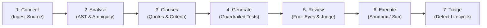
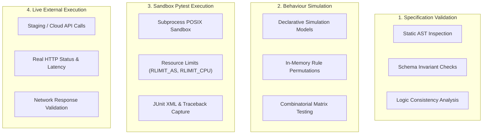
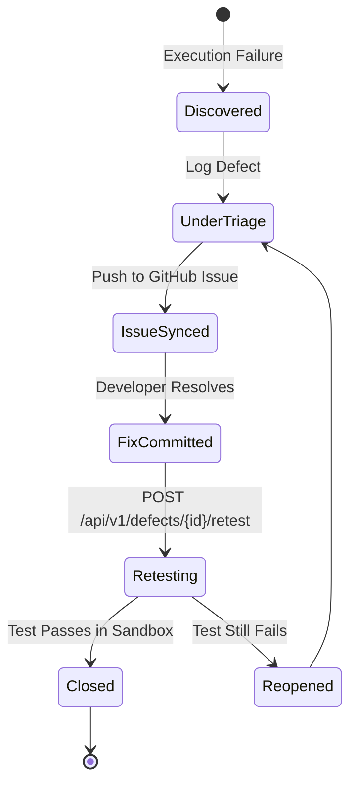

# TraceTest AI — Requirements Engineering & Verification Workflows

## 1. The Seven-Stage Quality Lifecycle

TraceTest AI automates the end-to-end software verification lifecycle through a disciplined seven-stage workflow:



| Stage | Activity | Key Inputs | Primary Output | Gatekeeper / Control |
|---|---|---|---|---|
| **1. Connect** | Upload requirement files or connect remote GitHub repository | PDF, DOCX, XLSX, MD, Git URL | Ingested document records, Git clone | SSRF URL inspection, file size limit (50MB) |
| **2. Analyse** | Extract structured text, parse code AST, detect ambiguities | Raw document text, Python/TS AST | Extracted content blocks, ambiguity cards | Format validation, semantic ambiguity scanner |
| **3. Clauses** | Decompose requirements into atomic numbered clauses | Extracted text & AST endpoints | Atomic clauses with verbatim quotes, Gherkin Given/When/Then | Verbatim source quote matching |
| **4. Generate** | Synthesize executable test cases and simulation policies | Approved clauses & criteria | Python `pytest`, Playwright, YAML policies | Static AST allowlist validator |
| **5. Review** | Conduct dual-control human governance and judge evaluation | Candidate test scripts | Approved test cases with cryptographic hashes | **Four-Eyes Principle** (author separation) |
| **6. Execute** | Run tests across sandboxes, simulation models, or live APIs | Test suites, environment configs | JUnit XML, exit codes, stdout/stderr streams | POSIX `setrlimit` sandbox (30s CPU, 512MB RAM) |
| **7. Triage** | Track discrepancies, generate reproduction steps, sync issues | Failed assertions, tracebacks | Defect records, GitHub Issues, retest reports | Defect verification workflow |

---

## 2. Requirements Ingestion & Extraction

TraceTest AI supports multi-modal intake across unstructured documents and source code repositories:

### 2.1 Unstructured Document Ingestion
The platform handles enterprise document types via specialized extractors:
- **PDF Documents (`.pdf`)**: Extracted using `pypdf` and `pdfplumber`, parsing layout, page numbers, text blocks, and structured tabular data.
- **Word Documents (`.docx`)**: Parsed via `python-docx`, preserving hierarchical section headers (H1-H4), bullet points, and callout tables.
- **Excel Spreadsheets (`.xlsx`, `.csv`)**: Processed using `openpyxl`, mapping sheets to business rule matrices, employee eligibility tables, and statutory rate lookups.
- **Markdown & Text (`.md`, `.txt`)**: Ingested directly with markdown structure parsing.

### 2.2 Source Code Ingestion & AST Grounding
For Code-Based projects (e.g. EchoBox, Cureonix):
- The platform dynamically clones remote GitHub repositories using an isolated, askpass-guarded Git client.
- Python codebases are parsed using Python's native `ast` module to extract:
  - Route definitions (FastAPI `@router.get`, Flask `@app.route`).
  - Handler functions and input arguments.
  - Data transfer objects (Pydantic models, dataclasses).
  - AWS Lambda entrypoints (`lambda_handler(event, context)`).
- Extracted code entities form the baseline requirements against which test cases are synthesized.

---

## 3. Requirement Normalization & Classification

Every extracted requirement is classified into one of four domain categories:
1. **Functional Requirement (FR)**: Specific system capabilities, user actions, and state transitions (e.g., "Employee clocks in via mobile application").
2. **Non-Functional Requirement (NFR)**: Performance, security, latency, and reliability requirements (e.g., "API response time must be under 200ms for 95% of requests").
3. **Business Rule (BR)**: Company policies and domain-specific calculations (e.g., "Overtime requests require manager approval before payroll processing").
4. **Statutory Policy (STAT)**: Legislative compliance mandates (e.g., "California Labor Code § 510: 1.5x pay after 8 hours in a workday, 2.0x after 12 hours").

---

## 4. Clause Decomposition & Verbatim Quote Grounding

To eliminate AI hallucination, requirements are decomposed into atomic, numbered clauses:
- **Atomic Independence**: Each clause represents a single verifiable condition or rule.
- **Verbatim Source Quotes**: Every clause must include an exact string excerpt copied from the source document, along with its page or section citation.
- **Provenance Linkage**: Clauses are assigned unique keys (e.g., `DAYFORCE-C01`, `ECHO-C05`) that persist across version updates.

```json
{
  "clause_key": "DAYFORCE-C01",
  "requirement_id": 901,
  "position": 1,
  "text": "Daily overtime is paid at 1.5x regular rate after 8 hours in a workday.",
  "source_quote": "Employees shall receive one and one-half times their regular rate of pay for all hours worked in excess of eight hours up to and including 12 hours in any workday.",
  "page_number": 4
}
```

---

## 5. Ambiguity & Contradiction Detection

The semantic intelligence engine scans requirements for verification hazards:
- **Lexical Ambiguity**: Flags subjective words lacking measurable boundaries:
  - *Vague Terms*: "fast", "reasonable", "user-friendly", "as appropriate", "sufficient", "real-time".
- **Boundary Omissions**: Flags missing threshold definitions (e.g. "Overtime applies on holidays", without defining which calendar determines holidays).
- **Cross-Document Contradictions**: Detects conflicting rules between documents (e.g., PRD specifies 8-hour overtime threshold while an ingested CBA specifies 7.5 hours).
- **Clarification Workflow**: Detected issues generate `requirement_clarifications` records requiring human resolution before test design proceeds.

---

## 6. Acceptance Criteria Synthesis (Given/When/Then)

Acceptance criteria are synthesized from approved clauses following the formal Gherkin standard:

```gherkin
Scenario: Daily Overtime Calculation (California § 510)
  Given an active non-exempt employee with regular hourly wage of $30.00
  When the employee works a shift of 10.0 hours on a single workday
  Then the first 8.0 hours must be paid at $30.00/hr ($240.00)
   And the remaining 2.0 hours must be paid at $45.00/hr ($90.00)
   And total gross pay for the shift must equal $330.00
```

Criteria are linked 1:1 or 1:N with clauses, ensuring every statutory condition has explicit testable preconditions, actions, and expectations.

---

## 7. Guardrailed Test Case Generation

Test generation produces executable test suites categorized into:
- **Positive Tests**: Validate expected behavior with valid inputs.
- **Negative Tests**: Validate error responses for invalid inputs or unauthorized access.
- **Boundary Tests**: Validate behavior at boundary thresholds (e.g., exactly 8.00 hours vs 8.01 hours).
- **Security Tests**: Validate token authorization, injection resistance, and encryption boundaries.
- **Permission Tests**: Validate role-based access control (RBAC).

### Static AST Allowlist Validation
Before a generated script is saved, it is parsed by `app/guardrails/ast_validator.py`. Scripts are rejected if they contain:
- Prohibited module imports: `os`, `sys`, `subprocess`, `socket`, `shutil`, `pickle`, `ctypes`.
- Banned built-in functions: `eval()`, `exec()`, `__import__()`, `open()`.
- Dunder traversal: `__class__`, `__subclasses__`, `__globals__`.

---

## 8. Dual-Control Review & LLM-as-a-Judge

TraceTest AI enforces enterprise governance via the **Four-Eyes Principle**:
- **Author Separation**: An engineer who generated or edited a test case cannot approve it. A different authenticated operator must review the test.
- **Adversarial Judge Scorecard**: An automated LLM Judge evaluates each test case:
  - *Statutory Grounding (Target: $\ge$ 95%)*: Assesses whether assertions correctly verify the statutory text.
  - *Verbatim Quote Fidelity (Target: 100%)*: Confirms that cited requirements exist identically in source documents.
  - *Logical Consistency*: Checks that test steps match the Given/When/Then criteria.
- **Immutable Approval Record**: Approving a test records the reviewer ID, timestamp, decision, and a SHA-256 hash of the test script, preventing silent tampering.

---

## 9. Test Execution Modes: Distinct Architectures

TraceTest AI provides four distinct execution modes, each designed for a specific verification tier:



### 9.1 Specification Validation
- **What it is**: Static verification of test specifications and requirement models without executing code.
- **How it runs**: Evaluates test syntax, schema invariants, AST compliance, and Gherkin completeness in milliseconds.
- **Use case**: Pre-execution linting and compliance gatekeeping.

### 9.2 Behaviour Simulation
- **What it is**: Fast combinatorial evaluation of business rule permutations against an in-memory declarative state machine.
- **How it runs**: Evaluates hundreds of shift, overtime, and leave permutations across the Reference HCM engine in sub-millisecond time.
- **Use case**: Mathematical correctness and regulatory edge-case matrices.

### 9.3 Sandbox Pytest Execution
- **What it is**: Actual execution of Python `pytest` scripts inside a security-hardened subprocess sandbox.
- **How it runs**: Invokes `pytest` under strict Linux `setrlimit` controls (30s CPU limit, 512MB RAM ceiling, 256 open files). Captures real stdout, stderr, JUnit XML, and stack traces.
- **Use case**: Verifying functional code, contract harnesses, and security assertions (such as `DEF-ECHO-006`).

### 9.4 Live External Execution
- **What it is**: Execution against running external HTTP staging environments or cloud backends.
- **How it runs**: Makes real network calls with timeout boundaries, capturing HTTP status codes, headers, and payload structures.
- **Use case**: End-to-end integration testing and regression detection on deployed services.

---

## 10. Traceability & Coverage Matrix

The Traceability Engine maintains bidirectional linkages across five artifacts:

$$\text{Document} \longleftrightarrow \text{Clauses} \longleftrightarrow \text{Acceptance Criteria} \longleftrightarrow \text{Test Cases} \longleftrightarrow \text{Executions} \longleftrightarrow \text{Defects}$$

### Coverage Formulas
- **Clause Coverage Rate**:
  $$\text{Coverage} = \frac{\text{Clauses linked to } \ge 1 \text{ Approved Test Case}}{\text{Total Clauses}} \times 100\%$$
- **Defect Verification Rate**:
  $$\text{Remediation Rate} = \frac{\text{Defects Verified via Passing Retest}}{\text{Total Defects}} \times 100\%$$

The interactive UI enables filtering by untested clauses, allowing engineers to identify and close specification gaps immediately.

---

## 11. Defect Lifecycle & Retesting

When a sandboxed or live test execution fails, TraceTest AI manages the defect lifecycle:



1. **Discovery**: Failure captured automatically from non-zero exit code or assertion failure.
2. **Defect Creation**: Logs defect record containing exact traceback, reproduction command, and linked clause key.
3. **GitHub Sync**: `POST /api/v1/defects/{id}/github-issue` exports the bug report to the linked GitHub repository.
4. **Retesting**: Once code is updated, `POST /api/v1/defects/{id}/retest` re-executes the exact failing test script in the sandbox. If assertions pass, the defect transitions to `CLOSED`.

