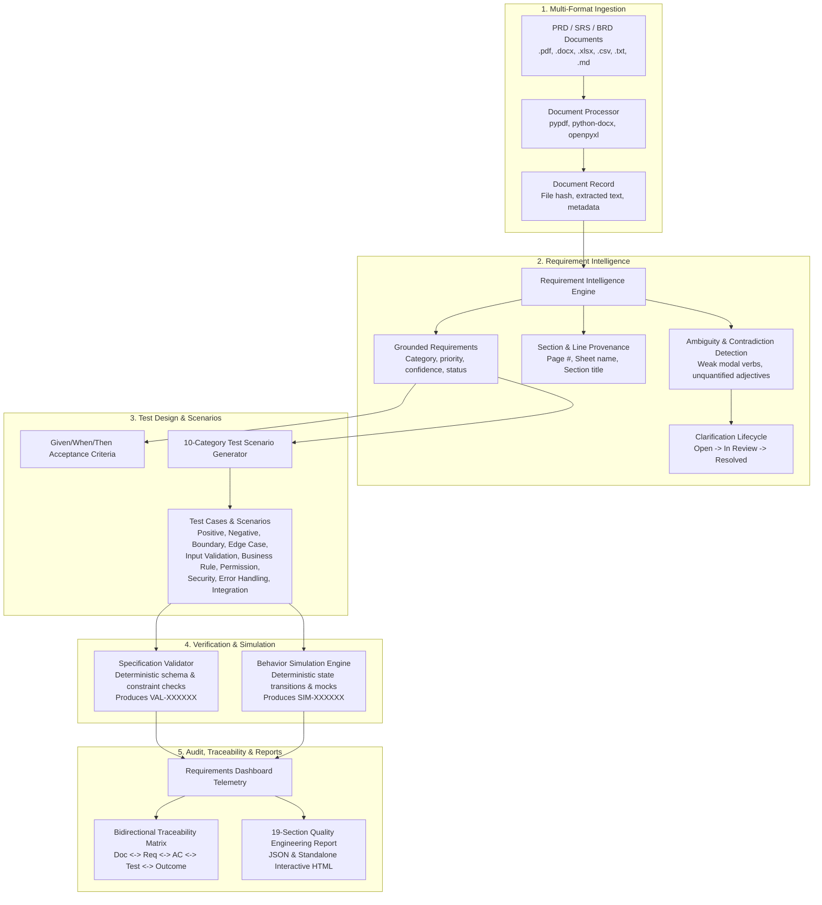

# Requirements-Based AI Quality Engineering Platform

## 1. Executive Summary & Product Direction

TraceTest AI has established **Requirements-Based AI Quality Engineering** as its primary product direction. In modern enterprise software development, testing bottlenecks and defects originate long before code is written—specifically in ambiguous specifications, unstated assumptions, missing boundary conditions, and untracked requirement modifications.

TraceTest AI operates as an intelligent **Product Requirements-to-Test Assistant**. Quality engineers and product managers can upload raw product requirements documents (PRDs, SRS, BRDs, API specs, spreadsheets, and markdown notes). TraceTest AI ingests these documents, parses structural sections, extracts atomic requirements with exact provenance, flags ambiguities and contradictions, generates structured Given/When/Then acceptance criteria, authors comprehensive 10-category test scenarios, executes deterministic specification validations and state simulations, and compiles bidirectional traceability matrices and 19-section quality audit reports.

Concurrently, existing **Code-Based** projects—such as EchoBox (`ECHO`) and Cureonix (`CUREON`)—remain fully supported with zero data loss or workflow disruption.

---

## 2. Platform Architecture & Data Flow



---

## 3. Multi-Format Document Ingestion Engine

The document processor (`backend/app/services/document_processor.py`) ingests multi-format requirements documents without external cloud dependencies:

| File Format | Parser Implementation | Provenance Granularity | Metadata Captured |
|---|---|---|---|
| **PDF (`.pdf`)** | `pypdf.PdfReader` | Page numbers (`page: 1`, `page: 2`) | Title, Author, Page count, SHA-256 digest |
| **Word (`.docx`)** | `python-docx` | Headings, Paragraphs, Tables | Document properties, Section hierarchy |
| **Excel (`.xlsx`)** | `openpyxl` (data-only mode) | Sheet names, Row ranges | Workbook sheets, Column dimensions |
| **CSV (`.csv`)** | Python `csv.reader` / `csv.Sniffer` | Row line numbers | Delimiter detection, Field count |
| **Markdown (`.md`)** | AST Markdown Heading Splitter | Headings (`#`, `##`, `###`) | Frontmatter, Outline tree |
| **Plain Text (`.txt`)** | Paragraph Boundary Segmenter | Paragraph blocks and line offsets | Character count, Encoding |

Each document undergoes cryptographic hashing (`SHA-256`) to ensure immutability and exact versioning. Parsed content retains structural markers (e.g., `[Page 2]`, `[Sheet: Billing]`, `[Section 3.1 Authentication]`) so that every extracted requirement and atomic clause points directly to its source text.

---

## 4. Grounded Requirement Intelligence & Clarification Lifecycle

### 4.1 Requirement Extraction & Classification
The requirement intelligence engine (`backend/app/services/requirement_intelligence.py`) segments document sections into distinct requirement items and classifies each into standardized enterprise categories:
- **`functional`**: Core user interactions and feature workflows.
- **`non_functional`**: Operational qualities, reliability, and usability thresholds.
- **`security`**: Authentication, authorization, token cryptography, encryption, and audit logging.
- **`performance`**: Latency limits, throughput targets, concurrency capacities, and timeouts.
- **`compliance`**: Regulatory rules (GDPR, HIPAA, SOC 2, ISO 27001, PCI-DSS).
- **`integration`**: Third-party APIs, webhooks, database bridges, and messaging protocols.

### 4.2 Ambiguity & Contradiction Detection
The engine evaluates requirement text against rule-based linguistic patterns:
- **Weak Modal Verbs**: Use of `should`, `could`, `may`, `might`, `ought to` instead of binding RFC 2119 keywords (`shall`, `must`).
- **Unquantified Adjectives**: Subjective descriptors such as `fast`, `user-friendly`, `efficient`, `scalable`, `robust`, `seamless`, `adequate`.
- **Vague Quantifiers**: `some`, `many`, `often`, `normally`, `typically`, `periodically`.
- **Contradictory Logic**: Opposing statements across sections (e.g. "anonymous feedback without auth" vs "user ID required in payload").

When ambiguities or contradictions are detected, the system automatically creates a `RequirementClarification` entry with `status="open"` and provides a suggested clarification prompt. Operators and stakeholders can review, answer, and resolve these items (`status="resolved"`), updating the requirement text to an unambiguous, testable state.

---

## 5. Test Design Engine: 10-Category Test Coverage

The test design engine (`backend/app/services/test_design.py`) generates structured acceptance criteria and comprehensive test scenarios for every approved requirement.

### 5.1 Given/When/Then Acceptance Criteria
Criteria follow Gherkin syntax:
- **Given**: Initial system state, user authentication, or data prerequisites.
- **When**: Action, trigger, or input submitted by user or external system.
- **Then**: Expected observable outcome, state mutation, and API response code.

### 5.2 10-Category Scenario Matrix
To prevent the common pitfall of only generating happy-path tests, the engine enforces 10 distinct scenario categories:
1. **Positive / Happy Path**: Valid inputs fulfilling normal business workflows.
2. **Negative**: Invalid inputs, malformed requests, and deliberate operator mistakes.
3. **Boundary Value**: Minimum, maximum, and threshold edge values (e.g., 0, 1, 99, 100, 101).
4. **Edge Case**: Rare but plausible scenarios (e.g., Leap Day, UTF-8 emojis, daylight saving shifts).
5. **Input Validation**: Schema constraints, regex mismatches, type coercions, null values.
6. **Business Rule**: Domain logic invariants, state transition rules, and dependency constraints.
7. **Permission / Role-Based Access**: Multi-tenant isolation, role checks (Operator vs Reviewer vs Admin).
8. **Security**: Injection attempts, missing headers, unauthenticated tokens, replay vectors.
9. **Error Handling**: Graceful degradation, informative error envelopes, idempotency on retries.
10. **Integration**: External service timeouts, network disconnections, webhook failures.

---

## 6. Execution Engine: Specification Validation (`VAL-*`) vs Simulation (`SIM-*`)

TraceTest AI maintains strict semantic segregation between static specification validation, behavioral simulation, and live software execution:

```
+-----------------------------------------------------------------------------------+
|                        EXECUTION ENGINE SEGREGATION                               |
+-----------------------------------+-----------------------------------------------+
| Specification Validation (VAL-*)  | Behavior Simulation (SIM-*)                   |
+-----------------------------------+-----------------------------------------------+
| * Execution Prefix: VAL-XXXXXX    | * Execution Prefix: SIM-XXXXXX                |
| * Deterministic static checks     | * Deterministic mock state transitions        |
| * Schema & constraint consistency | * Synthetic user flows & transaction models   |
| * Ambiguity & coverage audit      | * State machine reachability & invariants     |
| * Never claims to run code        | * Never misrepresents as live software test   |
+-----------------------------------+-----------------------------------------------+
| Live Application Testing (EX-*)   | Preserved for code-based targets (EchoBox)    |
+-----------------------------------+-----------------------------------------------+
```

- **Specification Validation (`VAL-*`)**: Validates that requirements contain non-empty clauses, verified acceptance criteria, test links, zero unresolved critical ambiguities, and schema compliance.
- **Behavior Simulation (`SIM-*`)**: Models domain state transitions against a `SimulationModel` (e.g. `ecommerce_checkout_model`, `banking_transfer_model`, `auth_lifecycle_model`) to evaluate business rule reachability without spinning up external cloud infrastructure.
- **Live Code Execution (`EX-*`)**: Reserved strictly for code-based projects (e.g. EchoBox Lambda execution against Moto or live AWS).

---

## 7. Bidirectional Traceability Matrix

The traceability service (`backend/app/services/requirements_dashboard.py`) produces an end-to-end matrix mapping every entity across the engineering lifecycle:

$$\text{Document Source} \longleftrightarrow \text{Requirement} \longleftrightarrow \text{Acceptance Criteria} \longleftrightarrow \text{Test Case} \longleftrightarrow \text{Validation / Simulation Outcome}$$

Each row in the matrix details:
- **Document**: Document title and filename with provenance page/section.
- **Requirement**: Identifier (`REQ-KEY-001`), title, category, priority, and approval status.
- **Acceptance Criteria**: Count and status of Given/When/Then clauses.
- **Test Scenarios**: Mapped test cases across positive, negative, and edge categories.
- **Latest Outcome**: Result (`passed`, `failed`, `needs_review`) and execution run key.
- **Traceability Status**: Complete (`covered`) vs Gap (`missing_tests`, `unresolved_ambiguity`).

---

## 8. 19-Section Enterprise Quality Report

TraceTest AI compiles an authoritative 19-section quality engineering audit report available via API (`GET /api/v1/projects/{id}/quality-reports`) and downloadable as standalone interactive HTML:

1. **Executive Summary**: Project scope, overall quality score, and release recommendation.
2. **Project & Scope Overview**: Metadata, business domain, product type, compliance standard.
3. **Ingested Documents & Provenance**: File hashes, formats, parsed sections, and line offsets.
4. **Requirements Inventory & Categorization**: Functional vs Non-Functional distribution.
5. **Ambiguity & Contradiction Analysis**: Resolved vs Open clarifications and impact rating.
6. **Acceptance Criteria Analysis**: Given/When/Then coverage and clause completeness.
7. **Test Scenario Design & Coverage Matrix**: 10-category breakdown and scenario counts.
8. **Specification Validation Results (`VAL-*`)**: Static validation outcomes and rule compliance.
9. **Behavior Simulation Results (`SIM-*`)**: State machine transition results and invariant proofs.
10. **Defect & Gap Analysis**: Identified specification flaws and missing boundaries.
11. **Bidirectional Traceability Matrix**: Complete audit table linking sources to outcomes.
12. **Compliance & Regulatory Readiness**: GDPR, HIPAA, SOC 2, or ISO 27001 mapping.
13. **Non-Functional & Operational Assessment**: Latency, reliability, and security assessments.
14. **Risk Assessment & Heatmap**: High-risk requirement clusters and failure impact.
15. **Boundary & Edge-Case Vulnerabilities**: Unhandled extremes and missing constraints.
16. **AI Grounding & Audit Provenance**: Quote verification rates and zero-hallucination proofs.
17. **Historical Execution Trends**: Pass rates across recent `VAL-*` and `SIM-*` runs.
18. **Actionable Recommendations**: Prioritized engineering tasks for product and QA teams.
19. **Sign-Off & Governance Record**: Formal sign-off readiness, timestamp, and audit hash.

---

## 9. Verification & Automated Test Coverage

The Requirements-Based Quality Engineering platform is verified by a dedicated test suite:

- **`backend/tests/test_requirements_based_platform.py`**:
  - `test_requirements_based_project_creation_and_empty_state`: Validates project creation, default metadata, and clean zero-state dashboard.
  - `test_legacy_code_based_projects_preserved`: Confirms EchoBox and Cureonix remain 100% functional with code-based dashboards and executions.
  - `test_document_ingestion_and_format_parsers`: Tests PDF, DOCX, XLSX, CSV, TXT, and MD parsers with section provenance.
  - `test_requirement_extraction_provenance_and_clarifications`: Verifies requirement categorization, ambiguity detection, and clarification lifecycle.
  - `test_requirement_review_approval_and_test_design`: Verifies approval flows, G/W/T generation, and 10-category test creation.
  - `test_execution_engine_spec_validation_and_simulation`: Verifies `VAL-*` validation and `SIM-*` behavioral simulation runs.
  - `test_traceability_matrix_and_quality_reports`: Validates bidirectional traceability generation and 19-section quality reports.
- **Frontend Vitest Suite (`frontend/tests/`)**:
  - Validates `RequirementsProjectDashboard` rendering, telemetry metrics, tab switches, and export actions.
- **Playwright E2E Suite (`backend/tests/test_playwright_e2e.py`)**:
  - Validates full QA journeys and WCAG accessibility standards across all viewports.
