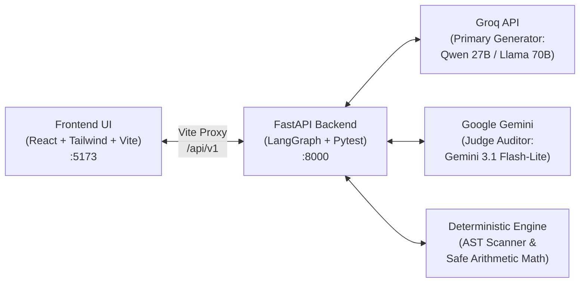

# TraceTest AI — Complete UI Walkthrough & User Guide

Welcome to **TraceTest AI**, the autonomous Requirements-to-Test AI platform built for the **Dayforce HCM Innovation Challenge**.

This guide is designed for **new users, QA engineers, HR policy analysts, and hackathon judges**. It walks through every screen in the application, explains the underlying workflows, and shows you how to test both **Code-based** and **No-Code** HCM scenarios.

---

## 1. Quick Start & Server Access

When running locally, TraceTest AI operates with two synchronized services:
* **Frontend Web Application**: [http://localhost:5173](http://localhost:5173)
* **Backend API & Swagger Docs**: [http://127.0.0.1:8000/docs](http://127.0.0.1:8000/docs)



---

## 2. Top Navigation & Dayforce Project Workspaces

At the top-left of the application header, you will see the **Workspace Selector** dropdown:

### Available HCM Workspaces:
1. **`TNA` — Time and Attendance (Default)**: Overtime rules, FLSA standards, California daily thresholds, shift differentials, and timesheet punch rounding.
2. **`PAY` — Payroll**: Gross-to-net calculations, tax brackets, wage garnishments, and retroactive pay.
3. **`LVE` — Leave Management**: Paid time off (PTO) accruals, FMLA leave, sick days, and carryover caps.
4. **`WFS` — Workforce Scheduling**: Shift bidding, minimum rest periods, and overtime avoidance alerts.
5. **`BEN` — Benefits**: Healthcare plan eligibility, 401(k) matching tiers, and open enrollment windows.

> **Why Workspaces Exist:** Enterprise HCM systems manage multiple distinct HR functions. Workspaces isolate requirements, test suites, and defect tickets so different teams can work independently without cross-contaminating data.

---

## 3. Screen-by-Screen Walkthrough

### 🏠 Page 1: Overview Dashboard (`/`)
* **URL:** `http://localhost:5173/`
* **Purpose:** Executive bird's-eye view of project quality, test coverage, and defect resolution velocity.
* **Key Components:**
  * **Hero Welcome Banner:** Summarizes the active workspace and guides you to the next action.
  * **4-Step Operational Guide:**
    1. *Ingest Requirements* ➔ 2. *AI Clause & Ambiguity Analysis* ➔ 3. *Safety & Grounding Audit* ➔ 4. *Test Suite Execution*.
  * **Test Case Status Breakdown:** Real-time visual bar charts tracking passed, failed, approved, and pending review tests.
  * **Defect Resolution Chart:** Tracks opened vs resolved defects week-over-week.
  * **Project Quality Matrix:** Summary table displaying test coverage percentage, total executions, and open defect counts per workspace.

---

### 📄 Page 2: Requirements Intelligence (`/requirements`)
* **URL:** `http://localhost:5173/requirements`
* **Purpose:** Ingest business documents and let AI decompose them into atomic, verifiable clauses.
* **How to Use:**
  1. Click **"Ingest Requirement"** to upload a document (`.pdf`, `.txt`, `.md`) or paste text directly.
  2. View the **AI Ambiguity Scanner**: The engine automatically highlights vague language (such as *"reasonable time"*, *"timely manner"*, or *"competitive wage"*) that could cause bugs in payroll implementations.
  3. Inspect **Extracted Clauses**: Each sentence is mapped to an immutable clause key (e.g., `CLAUSE-001`, `CLAUSE-002`) with quote fidelity tracking.

---

### 🧪 Page 3: Test Cases & Suites (`/tests`)
* **URL:** `http://localhost:5173/tests`
* **Purpose:** Browse all generated automated tests (both Python code unit tests and No-Code business rule tests).
* **Key Components:**
  * Filter tests by status (`passed`, `failed`, `pending_review`, `approved`).
  * Click any test case to view its **Source Quote Grounding**, expected vs actual assertions, and AST safety validation check.

---

### 🛡️ Page 4: Consumer Policy Monitoring (`/tests/monitoring`)
* **URL:** `http://localhost:5173/tests/monitoring`
* **Purpose:** Built specifically for **business consumers, HR directors, and compliance officers** (non-developers).
* **What it Shows:**
  * Translates developer test code into **Plain-English Business Guarantees** (e.g., *"California Daily Overtime: Employees working over 8 hours up to 12 hours receive 1.5x pay"*).
  * **Real-time Compliance Badges**: Shows **VERIFIED** or **ACTION REQUIRED** without technical jargon or stack traces.
  * **Clause Grounding Verification**: Proves every test rule originates directly from signed policy text.

---

### ⚖️ Page 5: QA Approval Workspace & LLM-as-a-Judge (`/tests/review`)
* **URL:** `http://localhost:5173/tests/review`
* **Purpose:** Dual-control human-in-the-loop review for QA Leads.
* **How LLM-as-a-Judge Works:**
  * Uses **Google Gemini 3.1 Flash-Lite** as an independent, adversarial auditor.
  * **Flagging-Only Architectural Invariant:** The AI Judge is strictly prohibited from auto-approving tests. It only **flags** ungrounded assertions, missing boundary conditions, or inverted logic.
  * A human QA lead reviews the judge's critique and makes the final decision: **Approve**, **Reject**, or **Request Changes**.

---

### ⚡ Page 6: Test Executions & Sandboxing (`/executions`)
* **URL:** `http://localhost:5173/executions`
* **Purpose:** Live test execution monitoring inside isolated execution sandboxes.
* **What it Shows:**
  * Step-by-step test execution logs.
  * Wall-clock runtime, memory utilization, and pass/fail exit codes.
  * Network isolation enforcement status (proves tests cannot leak data or access external services).

---

### 🐞 Page 7: Automated Defect Management (`/defects`)
* **URL:** `http://localhost:5173/defects`
* **Purpose:** When a test execution fails against the HCM codebase, a defect ticket is automatically filed.
* **Key Features:**
  * **Traceability Linkage:** Every defect links directly to the failing test case AND the originating policy clause.
  * Stack traces, root cause categorization (e.g., *Off-by-One Threshold Error*), and reproduction steps.

---

### 🔗 Page 8: Traceability Matrix (`/traceability`)
* **URL:** `http://localhost:5173/traceability`
* **Purpose:** Complete end-to-end verification mapping.
* **What it Displays:**
  * A structured matrix connecting:
    $$\text{Policy Clause} \longrightarrow \text{Generated Test Case} \longrightarrow \text{Execution Run} \longrightarrow \text{Defect Ticket}$$
  * Ensures 100% test coverage with zero orphaned clauses.

---

### 🤖 Page 9: Multi-Agent Simulation & Health Monitoring (`/simulation`)
* **URL:** `http://localhost:5173/simulation`
* **Purpose:** Interactive demonstration lab and agent health monitoring screen requested by the challenge evaluators.

#### 1. The 9-Stage Autonomous Pipeline
Click **"Run 9-Stage Simulation"** and scroll down to watch all 9 stages activate in sequence:
* **Stage 01 — Ingestion & Parser:** Normalizes raw policy text into structured clauses.
* **Stage 02 — AST Sanitizer:** Scans for forbidden Python calls (`eval`, `exec`, `os.system`) and prompt injection attacks.
* **Stage 03 — Quote Verifier:** Anchors assertions to literal sentences in the policy document.
* **Stage 04 — YAML Schema Synthesizer:** Compiles clauses into a safe arithmetic rule dictionary.
* **Stage 05 — Boundary Condition Generator:** Synthesizes threshold test cases ($40.0\text{h}$, $40.1\text{h}$, $0.0\text{h}$, negative hours).
* **Stage 06 — Deterministic Safe Interpreter:** Evaluates timesheet calculations without running external code.
* **Stage 07 — LangGraph Repair Loop:** Catches calculation mismatches, receives feedback, and repairs rules automatically.
* **Stage 08 — Mutation Fault Injector:** Deliberately mutates a threshold to prove test suites fail when bugs are injected.
* **Stage 09 — LLM-as-a-Judge Auditor:** Dispatches test artifacts to Gemini for independent adversarial critique.

#### 2. Golden HCM Policy Presets
Click any of the preset buttons to switch active policies:
* **`POL001`**: Standard Weekly Overtime (FLSA 40.0h).
* **`POL002`**: California Daily Overtime (Daily 8.0h threshold at 1.5x).
* **`POL003`**: California Double-Time Escalation (Daily 8h at 1.5x, Daily 12h at 2.0x).
* **`POL004`**: Collective Bargaining Agreement (CBA 35.0h workweek).
* **`POL005`**: Heavy Industry Double-Time Cap (Daily 10h at 2.0x).

#### 3. Interactive Timesheet Calculator
* In the **"Interactive Timesheet Calculator"** section, enter shift hours (e.g., `8, 10, 13`).
* Click **"Calculate Timesheet"**.
* The calculator uses the active policy's mathematical rules to compute:
  * Regular Hours
  * Overtime Hours ($1.5\times$)
  * Double-Time Hours ($2.0\times$)
  * Total Equivalent Pay Hours

#### 4. Custom Policy Natural Language Ingestion Box
* Located at the bottom of `/simulation`.
* Allows you to paste **any custom English policy** (full formal text or short summary) and compile it into No-Code YAML rules live!

---

## 4. Hands-on Tutorial: Ingesting a Custom Policy

Try this 2-minute walkthrough right now in your browser:

1. Open [http://localhost:5173/simulation](http://localhost:5173/simulation).
2. Scroll to the bottom card: **"Custom Policy Ingestion & Natural Language Parsing"**.
3. Paste either the **Formal Policy Specification** or the **Short Summary**:

#### Option A: Formal Policy Specification
```text
Healthcare Staffing Shift & Tiered Differential Policy (HC-CA-2026): Non-exempt healthcare workers are scheduled on 8-hour shifts. Any hours worked in excess of 8 hours up to 12 hours in a single workday shall be compensated at one and one-half times (1.5x) the employee's regular rate. Any hours worked in excess of 12 hours in a single workday shall be compensated at double time (2.0x). Employees working in excess of 36 aggregate regular hours in a designated workweek shall receive overtime compensation at 1.5x. Timesheet punch records are rounded to the nearest 15-minute interval (0.25 hours).
```

#### Option B: Short Business Rule Summary
```text
Non-exempt employees working in excess of 8 hours up to 12 hours in a single workday shall receive overtime at 1.5x. Hours worked beyond 12 hours in a workday receive double time at 2.0x. Hours worked over 36 hours in a workweek receive 1.5x.
```

4. Click **"Compile & Ingest Policy"**.
5. Watch the system:
   * Scan AST allowlists.
   * Extract daily ($8.0\text{h}$), double-time ($12.0\text{h}$), and weekly ($36.0\text{h}$) thresholds.
   * Run the Safe Arithmetic Interpreter (displaying Red ➔ Green ➔ Mutation tests).
6. Scroll up to the **Interactive Timesheet Calculator**, type `8, 10, 14`, and click **"Calculate Timesheet"** to see the custom payroll math computed live!

---

## 5. AI Providers & Key Configuration Summary

| Provider | Active Model | Role in TraceTest AI | Status |
| :--- | :--- | :--- | :--- |
| **Groq** | `qwen/qwen3.8-27b` (Fallback: `openai/gpt-oss-120b`) | Primary Open-Weight Test Generator | **Live & Verified** |
| **Google Gemini** | `gemini-3.1-flash-lite` (Fallback: `gemini-flash-lite-latest`) | LLM-as-a-Judge Independent Auditor | **Live & Verified** |
| **Deterministic Engine** | AST & Safe Python Arithmetic | Zero-cost local runner (No eval/exec) | **Offline Fallback Ready** |

*Both live keys and offline deterministic modes are fully configured in `.env` and `config.py`.*
