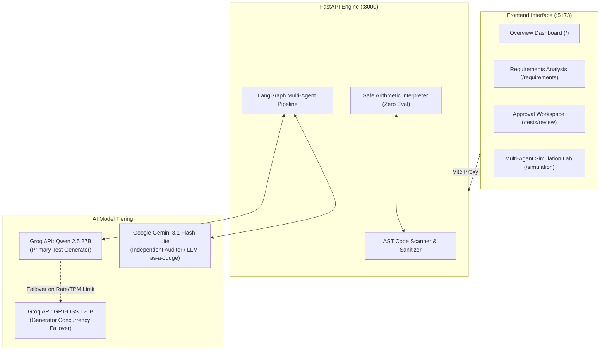
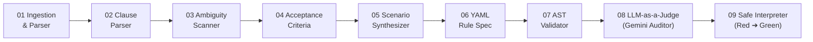
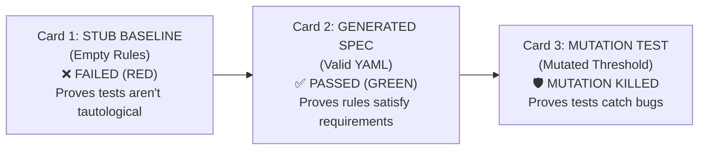

# TraceTest AI — Complete UI Walkthrough & User Guide

Welcome to **TraceTest AI**, the autonomous Requirements-to-Test AI platform built for the **Dayforce HCM Innovation Challenge**.

This guide is designed for **new users, QA engineers, HR policy analysts, and hackathon judges**. It walks through every screen in the application, explains the underlying workflows, and provides an exhaustive deep dive into the **Multi-Agent Simulation Engine** (`/simulation`) with its **Red ➔ Green ➔ Mutation** test verification suite.

---

## 1. Quick Start & Service Topology

When running locally, TraceTest AI operates with two synchronized services:
* **Frontend Web Application**: [http://localhost:5173](http://localhost:5173)
* **Backend API & Swagger Docs**: [http://127.0.0.1:8000/docs](http://127.0.0.1:8000/docs)



---

## 2. Top Navigation & Dayforce Project Workspaces

At the top-left of the application header, the **Workspace Selector** switches between Dayforce HCM operational domains:

| Key | Project Workspace | Domain Focus |
| :--- | :--- | :--- |
| **`TNA`** | **Time and Attendance (Default)** | FLSA standards, California daily overtime (8h/12h), punch rounding (15m), and shift differentials. |
| **`PAY`** | **Payroll Management** | Gross-to-net calculations, tax brackets, wage garnishments, retroactive pay, and FLSA overtime. |
| **`LVE`** | **Employee Leave Management** | PTO accruals, carryover caps, FMLA leave entitlements, and multi-tier approval workflows. |
| **`WFS`** | **Workforce Scheduling** | Shift bidding, minimum rest periods, minor-labor restrictions, and premium scheduling. |
| **`BEN`** | **Benefits and Eligibility** | Healthcare plan enrollment, full-time threshold qualification, and 401(k) matching tiers. |

> **Enterprise Isolation Invariant:** Workspaces maintain strict data boundaries. A defect discovered in `PAY` cannot pollute requirements in `TNA`, ensuring clear auditing trails for compliance examinations.

---

## 3. Screen-by-Screen Walkthrough

### 🏠 1. Overview Dashboard (`/`)
* **URL:** `http://localhost:5173/`
* **Purpose:** Executive command center for test coverage, defect velocity, and operational health.
* **Key Components:**
  * **Hero Welcome Banner:** Identifies active workspace and provides quick links to simulation and requirement analysis.
  * **4-Step Operational Pipeline:** Visual roadmap from Ingestion ➔ AI Analysis ➔ Safety Audit ➔ Test Suite Execution.
  * **Status Breakdown Matrix:** Visual tracking of Passed, Failed, Approved, and Pending Review test cases.
  * **Defect Resolution Velocity:** Trend charts illustrating open vs resolved defects across HCM releases.

---

### 📄 2. Requirements Intelligence (`/requirements` & `/requirements/:id`)
* **URL:** `http://localhost:5173/requirements`
* **Purpose:** Ingest business specifications, decompose them into atomic clauses, scan for ambiguities, and synthesize tests.
* **Key Tabs in Requirement Details:**
  1. **Clauses:** Numbered atomic obligations (`C1`, `C2`, etc.) with verbatim text and initial ambiguity flags.
  2. **AI Analysis:** Deep AI clause interpretation, missing information detection, potential conflicts, and clarifying questions. Includes the **"Generate acceptance criteria and tests"** workflow trigger with live step tracking.
  3. **Acceptance Criteria:** Given/When/Then criteria grounded with verbatim source quotes.
  4. **Tests:** Full list of synthesized test cases citing specific clauses.
  5. **Versions & Change Impact:** Compare historical versions and assess impacted test suites when policy rules change.

---

### 🧪 3. Test Cases & Test Management (`/tests` & `/tests/:id`)
* **URL:** `http://localhost:5173/tests`
* **Purpose:** Repository of all synthesized Python tests and No-Code business rule tests.
* **Key Details:**
  * Filter by category: `Boundary`, `Functional`, `Negative`, `Compliance`, `Security`, `Integration`.
  * Inspect source clause citations and AST allowlist compliance status.

---

### 🛡️ 4. Consumer Policy Monitoring (`/tests/monitoring`)
* **URL:** `http://localhost:5173/tests/monitoring`
* **Purpose:** Non-technical view for HR directors and compliance officers.
* **What it Shows:**
  * Translates technical assertions into plain-English guarantees.
  * Live status badges: **VERIFIED** or **ACTION REQUIRED**.

---

### ⚖️ 5. Approval Workspace & Dual-Control Review (`/tests/review`)
* **URL:** `http://localhost:5173/tests/review`
* **Purpose:** Human-in-the-loop review queue for QA leads.
* **Dual-Control Governance Rule:** Test authors cannot self-approve their tests.
  * To approve a test, use the **Persona Switcher** in the top navigation bar to switch from **Alex Kowalski (Operator)** to **Riley Chen (Reviewer)**.
  * Review the AI Auditor findings, enter comments, and click **Approve** or **Request Changes**.

---

### ⚡ 6. Test Executions & Sandboxing (`/executions`)
* **URL:** `http://localhost:5173/executions`
* **Purpose:** Live test execution inside isolated process sandboxes with strict memory and time limits.

---

### 🐞 7. Automated Defect Management (`/defects`)
* **URL:** `http://localhost:5173/defects`
* **Purpose:** Auto-filed defect tickets linked directly to the failing test case and the originating policy clause.

---

### 🔗 8. Traceability Matrix (`/traceability`)
* **URL:** `http://localhost:5173/traceability`
* **Purpose:** Complete bidirectional mapping:
  $$\text{Policy Clause} \longrightarrow \text{Acceptance Criteria} \longrightarrow \text{Automated Test} \longrightarrow \text{Execution Run} \longrightarrow \text{Defect Ticket}$$

---

## 4. Multi-Agent Simulation & Health Monitoring (`/simulation`) — Complete Deep Dive

The **Simulation Lab** (`/simulation`) is the interactive core of TraceTest AI. It demonstrates autonomous multi-agent verification in real time, featuring interactive timesheet evaluation, AST code safety enforcement, and **Red ➔ Green ➔ Mutation** test verification.

---

### A. The 9-Stage Autonomous Pipeline Graph

At the top of `/simulation`, the **Multi-Agent Verification Pipeline Graph** visualizes the 9 sequential stages that process HCM policies. 



#### Detailed Breakdown of All 9 Stages:

1. **Stage 01 — Ingestion & Document Parser**: Normalizes UTF-8 policy text, strips control characters, computes SHA-256 content hashes, and runs Level 1 Prompt Injection filters.
2. **Stage 02 — Clause Parser (Deterministic AST)**: Decomposes natural language into numbered atomic clauses without using LLMs, ensuring 100% determinism.
3. **Stage 03 — Ambiguity & Gap Scanner**: Scans clauses for vague lexicon (*"reasonable time"*, *"competitive wage"*) and missing legal obligations (*"shall"*, *"must"*).
4. **Stage 04 — Acceptance Criteria Synthesis**: Compiles clauses into Given/When/Then Gherkin scenarios with verbatim source quotation tracking.
5. **Stage 05 — Scenario & Boundary Synthesizer**: Generates boundary conditions (e.g., $7.99\text{h}$, $8.00\text{h}$, $8.01\text{h}$, $11.99\text{h}$, $12.01\text{h}$) to stress-test HCM calculation logic.
6. **Stage 06 — YAML Rule Specification**: Assembles business rules into a declarative, non-executable YAML schema.
7. **Stage 07 — AST Code Validator**: Scans generated test code against Python AST allowlists. Completely blocks `eval()`, `exec()`, `os.system()`, and socket connections.
8. **Stage 08 — LLM-as-a-Judge Auditor (Adversarial Quality Consensus)**:
   * **Model**: **Google Gemini 3.1 Flash-Lite** (separate model family from generator).
   * **Role**: Adversarial auditor checking for ungrounded assertions, missing boundaries, and inverted logic.
   * **Strict Rule**: Cannot approve tests; only flags issues for human review.
   * 👉 **How to view the Judge Trace**: Click directly on the **Stage 08 box** in the pipeline graph. The **Stage Inspector** below will instantly reveal the Gemini audit log, consensus score (e.g., $98\%$), and adversarial critique!
9. **Stage 09 — Safe Interpreter (Red ➔ Green Verification)**: Executes the compiled YAML rules through a pure mathematical interpreter (zero eval) across all test scenarios.

---

### B. Golden HCM Policy Presets

Directly below the pipeline graph, you can select any of the 5 pre-configured enterprise policies:

* **`POL001` — Standard Weekly Overtime (FLSA Standard)**: Non-exempt employees working in excess of $40\text{h}$ weekly receive $1.5\times$ regular pay. (US-Federal).
* **`POL002` — California Daily Overtime**: Overtime at $1.5\times$ after $8\text{h}$ daily; standard pay up to $8\text{h}$. (US-California).
* **`POL003` — California Double-Time Escalation**: Two-tiered escalation: $1.5\times$ for hours $8\text{h} \text{ to } 12\text{h}$, and $2.0\times$ (double time) for hours exceeding $12\text{h}$ in a single workday.
* **`POL004` — Collective Bargaining Agreement (CBA 35h)**: Union contract policy with an accelerated $35\text{h}$ regular weekly threshold before overtime applies.
* **`POL005` — Heavy Industry Double-Time Cap**: Hazardous shift policy with a strict daily $10\text{h}$ double-time trigger and meal-break penalties.

---

### C. The 3 Verification Tabs (Deep Dive)

Below the stage cards, three interactive tabs let you inspect test verification, code generation, and guardrails:

```
┌───────────────────────────────────────┬───────────────────────────────┬──────────────────────────────────┐
│ 1. Live Safe Interpreter (Red ➔ Green)│ 2. No-Code Policy YAML Engine │ 3. Clauses & Ambiguity Guardrails│
└───────────────────────────────────────┴───────────────────────────────┴──────────────────────────────────┘
```

---

#### 🧪 Tab 1: Live Safe Interpreter (`Red ➔ Green ➔ Mutation`)

This tab proves that tests are mathematically sound, sensitive to regressions, and non-tautological through a **3-Card Verification Matrix**:



##### 1. Card 1: `1. STUB SPEC BASELINE` (Status: `FAILED - RED`)
* **What it does**: Runs the test scenarios against an empty (null) policy rule specification where no overtime or multipliers exist.
* **Why it must fail**: If a test suite passes when run against a blank stub, the tests are tautological (rubber-stamping/worthless). Failing on the stub proves the tests genuinely assert real behavior.
* **Metrics displayed**:
  * Total Scenarios (e.g. 5)
  * Failed (Expected): 2 to 4
  * Overtime Caught: $0\%$ (Null)

##### 2. Card 2: `2. GENERATED YAML SPEC` (Status: `PASSED - GREEN`)
* **What it does**: Runs the test scenarios against the compiled, valid YAML rules using the safe arithmetic interpreter.
* **Result**: All assertions pass green.
* **Metrics displayed**:
  * Total Scenarios (e.g. 5)
  * Passed Tests: 5 of 5
  * Execution Speed: $\approx 1.4\text{ ms}$ (instant, zero-latency local execution)

##### 3. Card 3: `3. MUTATION TEST` (Status: `MUTATION KILLED`)
* **What it does**: The engine intentionally introduces a fault into the policy rules (for example, mutating the $40\text{h}$ weekly threshold to $50\text{h}$, or shifting daily overtime from $8\text{h}$ to $18\text{h}$).
* **Why it matters**: It verifies **test sensitivity**. If a bug was accidentally introduced into payroll code, would these tests catch it? 
* **Result**: The mutant is caught immediately, causing assertions to fail. The badge proudly displays **`MUTATION KILLED`**.
* **Metrics displayed**:
  * Mutation Applied: e.g., `Mutated RULE-W40 threshold`
  * Mutant Caught: `YES (Killed)`
  * Failing Tests: 2 to 4

##### Detailed Verification Scenarios Table
Directly below the 3 cards is the live execution table:
* **Scenario Name**: (e.g., *Standard 40h workweek*, *Overtime 45h workweek*, *Under threshold 38h week*, *Heavy overtime 48h week*, *Zero hours worked*).
* **Input Daily Shifts**: Daily shift array, such as `[8, 8, 8, 8, 8]` or `[10, 10, 10, 10, 8]`.
* **Expected Pay Breakdown**: Exact hours expected for Regular, Overtime ($1.5\times$), Double-Time ($2.0\times$), and Pay Equivalent.
* **Safe Interpreter Output**: What the deterministic mathematical engine actually calculated.
* **Verification Status**: Green `PASSED` badge.

##### Interactive Timesheet Calculator (Zero Latency)
* Input custom comma-separated daily shifts (e.g. `8, 10, 14, 8, 6`).
* Click **"Calculate Pay Hours"**.
* Instantly computes:
  * Total Hours Worked
  * Regular Hours ($1.0\times$)
  * Overtime Hours ($1.5\times$)
  * Double-Time Hours ($2.0\times$)
  * Pay Equivalent Hours

---

#### 📜 Tab 2: No-Code Policy YAML Engine

This tab demonstrates TraceTest AI's **No-Code compilation** capabilities:

1. **Compiled YAML Specification Panel**:
   Displays the clean, declarative YAML format generated from the policy text:
   ```yaml
   policy_id: POL-CUSTOM
   jurisdiction: US-California
   rules:
     - id: RULE-D8
       type: daily_overtime
       threshold_hours: 8.0
       multiplier: 1.5
     - id: RULE-D12
       type: daily_double_time
       threshold_hours: 12.0
       multiplier: 2.0
     - id: RULE-W36
       type: weekly_overtime
       threshold_hours: 36.0
       multiplier: 1.5
   rounding:
     interval_minutes: 15
     increment_hours: 0.25
   ```
2. **Decomposed HCM Rules Panel**:
   Cards showing each parsed rule with its threshold hours, rate multiplier, and maximum daily/weekly caps.
3. **Custom Policy Ingestion & Live AI Toggle**:
   * **Preset Buttons**: Quick shortcuts for *CA 8h/12h Two-Tier*, *CBA 35h Workweek*, and *Field 10h Double-Time*.
   * **Textarea**: Paste any business policy text in plain English.
   * **Invoke Live AI Checkbox**:
     * **Unchecked**: Runs lightning-fast deterministic baseline ($<300\text{ ms}$).
     * **Checked**: Dispatches live requests to **Groq (Qwen 2.5 27B)** for generation and **Google Gemini 3.1 Flash-Lite** for adversarial judging, with live token tracing.
   * **Button**: Click **"Compile Custom Policy to YAML & Run"** to compile and run the entire suite.

---

#### 📋 Tab 3: Clauses & Ambiguity Guardrails

This tab shows how raw text is structured and safeguarded:

1. **Atomic Clauses Panel (Left Side)**:
   * Displays every clause extracted from the policy text (e.g. `POL-CUSTOM.C1`, `C2`, etc.).
   * Shows $100\%$ traceability coverage.
   * Category classification badges: `FUNCTIONAL` vs `COMPLIANCE`.
2. **Ambiguity & Gap Scanner (Right Side)**:
   * Automatically detects underspecified terms or missing thresholds.
   * Displays severity badges: `HIGH` (e.g., missing numerical threshold or lack of explicit obligation words) vs `LOW`.
   * Provides **Actionable Recommendations**: e.g., *"Calculate strictly as max(0, total_regular - 40.0)"*.
3. **Gherkin BDD Acceptance Criteria**:
   * Generates clean Given/When/Then criteria grounded in the clauses:
     ```gherkin
     Given employee timesheet, When hours match RULE-D12 (12.0h), Then apply 2.0x rate.
     Given employee timesheet, When hours match RULE-D8 (8.0h), Then apply 1.5x rate.
     ```

---

## 5. Step-by-Step Tutorial: Ingesting a Custom Policy

Follow these steps in your browser:

1. Navigate to **Agent Simulation** ([http://localhost:5173/simulation](http://localhost:5173/simulation)).
2. Click the **"No-Code Policy YAML Engine"** tab.
3. In the custom policy box, paste the following healthcare specification:
   ```text
   Healthcare Staffing Shift & Tiered Differential Policy (HC-CA-2026): Non-exempt healthcare workers are scheduled on 8-hour shifts. Any hours worked in excess of 8 hours up to 12 hours in a single workday shall be compensated at one and one-half times (1.5x) the employee's regular rate. Any hours worked in excess of 12 hours in a single workday shall be compensated at double time (2.0x). Employees working in excess of 36 aggregate regular hours in a designated workweek shall receive overtime compensation at 1.5x. Timesheet punch records are rounded to the nearest 15-minute interval (0.25 hours).
   ```
4. *(Optional)* Check **"Invoke Live AI"** to use live Groq and Gemini models.
5. Click **"Compile Custom Policy to YAML & Run"**.
6. Switch to the **"Live Safe Interpreter (Red ➔ Green)"** tab:
   * Observe **Card 1 (Stub)** fail as expected.
   * Observe **Card 2 (YAML Spec)** pass green in $\approx 1.4\text{ ms}$.
   * Observe **Card 3 (Mutation)** report `MUTATION KILLED`, confirming regression protection.
7. Switch to the **"Clauses & Ambiguity Guardrails"** tab to inspect the 5 extracted clauses and the ambiguity scanner flags.
8. Scroll to the **Interactive Timesheet Calculator**, enter `8, 10, 13`, and verify the pay calculation live!

---

## 6. AI Model Hierarchy & Role Separation

TraceTest AI strictly adheres to the **Model Family Separation Principle**:

```
┌─────────────────────────────────────────────────────────────┐
│                    TEST GENERATION ENGINE                   │
│                                                             │
│  • Primary Generator:   Groq (qwen/qwen3.8-27b)             │
│  • Generator Failover:  Groq (openai/gpt-oss-120b)          │
└──────────────────────────────┬──────────────────────────────┘
                               │ Clauses, ACs, Test Cases
                               ▼
┌─────────────────────────────────────────────────────────────┐
│              INDEPENDENT QUALITY AUDITOR / JUDGE            │
│                                                             │
│  • LLM-as-a-Judge:      Google Gemini (gemini-3.1-flash-lite│
│  • Role:                Adversarial audit & Grounding Check │
│  • Authority:           Flagging-only (Cannot self-approve) │
└──────────────────────────────┬──────────────────────────────┘
                               │ Audit Findings & Verdict
                               ▼
┌─────────────────────────────────────────────────────────────┐
│                  DUAL-CONTROL HUMAN REVIEW                  │
│  • Human Reviewer:      Riley Chen (Reviewer Persona)       │
└─────────────────────────────────────────────────────────────┘
```

* Both live API keys and offline deterministic engines are fully operational and verified.
