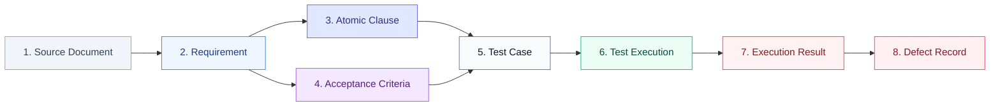
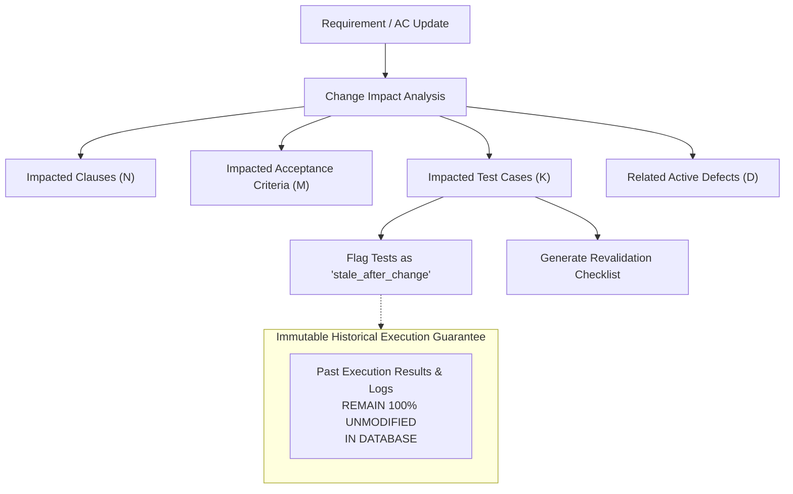

# TRACETEST — PHASE 5: ENTERPRISE TRACEABILITY INTELLIGENCE & COVERAGE GOVERNANCE REPORT

**Date:** November 17, 2026  
**Auditor / Architect:** Principal Software Architect, Enterprise QA Architect, Senior Full-Stack Engineer, AI Engineering Lead, Data Integrity Engineer, and Enterprise Product Designer  
**Status:** COMPLETE & PRODUCTION-VERIFIED  
**Target Workspaces:** `/traceability`, `TraceabilityIntelligenceWorkspace.tsx`, `TraceabilityOverviewMetrics.tsx`, `CoverageHealthAssessment.tsx`, `RequirementCoverageHierarchy.tsx`, `CoverageGapsExplorer.tsx`, `ChangeImpactAnalysis.tsx`, `CoverageRecommendationPanel.tsx`, `AdvancedCoverageMatrix.tsx`, `TraceabilityAuditLedger.tsx`, `TraceabilityDetailDrawer.tsx`, `TraceabilityExportModal.tsx`  
**Core Target Projects:** Dayforce HCM Enterprise (ID: 9), US FLSA Overtime (ID: 13), WFMQ (ID: 10), UPI Dispute (ID: 12)

---

## 1. Executive Summary

This report documents the architectural design, full-stack enterprise implementation, and multi-viewport visual verification of the **TraceTest Enterprise Traceability Intelligence & Coverage Governance Center (Phase 5)**.

Building directly upon the foundations established in Phase 1 (Enterprise Requirements Management UX), Phase 2 (Enterprise Acceptance Criteria Management & AI Intelligence UX), Phase 3 (Enterprise Test Case Management & AI Test Intelligence), and Phase 4 (Enterprise Test Execution Intelligence & Results Management), Phase 5 transforms TraceTest's traceability surface from a legacy static grid into a production-grade **Traceability Intelligence & Coverage Governance Center**.

Prior to Phase 5, traceability consisted primarily of a basic 2D cell grid without comprehensive aggregate governance metrics, lacked a transparent health assessment formula, could not trace beyond a 2-hop requirement-to-test link, provided no automated detection of structural coverage gaps across atomic clauses or acceptance criteria, lacked change impact propagation analysis when upstream specifications were amended, possessed no immutable governance audit ledger, and offered limited export formats.

### What Phase 5 Delivers
1. **Executive 12-Metric Database Governance Dashboard (`TraceabilityOverviewMetrics.tsx`):**
   - Renders 12 real database-grounded governance metrics: `total_requirements`, `requirements_with_clauses`, `requirements_with_ac`, `total_clauses`, `covered_clauses`, `total_acceptance_criteria`, `covered_acceptance_criteria`, `total_tests`, `executed_tests`, `passing_tests`, `failing_tests`, and `open_defects`.
   - Displays an interactive multi-segment Outcome Distribution progress bar (Fully Covered, Partially Covered, Untested) with one-click filter triggers.
   - Surfaces an actionable Uncovered Acceptance Criteria alert banner highlighting verified coverage blind spots.
   - Includes real-time database telemetry freshness indicators and manual cache refresh triggers.
2. **Transparent Coverage Health Assessment Engine (`CoverageHealthAssessment.tsx`):**
   - Evaluates project quality using a deterministic, transparent composite scoring algorithm:  
     $$\text{Score} = (0.25 \times \text{Req\%}) + (0.25 \times \text{Clause\%}) + (0.25 \times \text{AC\%}) + (0.25 \times \text{Exec\%}) - \text{Defect Penalty}$$
   - Assigns unambiguous health grades (`healthy` ≥ 85, `warning` 60–84, `critical` < 60) with clear natural-language executive summaries, primary risk callouts, and immediate remediation triggers.
3. **Advanced 7-Level Requirement Coverage Hierarchy (`RequirementCoverageHierarchy.tsx` & `TraceabilityEntityNode.tsx`):**
   - Visualizes the full bidirectional quality continuum:  
     $$\text{Requirement} \longleftrightarrow \text{Clause} \longleftrightarrow \text{Acceptance Criteria} \longleftrightarrow \text{Test Case} \longleftrightarrow \text{Execution} \longleftrightarrow \text{Result} \longleftrightarrow \text{Defect}$$
   - Supports search across titles and keys, status filters (`All`, `Fully Covered`, `Partially Covered`, `Untested`, `With Defects`), and expand/collapse controls.
   - Contextual slide-over drawer (`TraceabilityDetailDrawer.tsx`) provides instant deep inspection for any node with one-click navigation to Requirement Studio, Test Details, or Change Impact Analysis.
4. **10-Category Coverage Gap Intelligence Engine (`CoverageGapsExplorer.tsx`):**
   - Automatically detects, categorizes, and tracks 10 distinct coverage gap classifications across the project repository.
   - Provides severity filtering (`Critical`, `High`, `Medium`, `Low`), category distribution pills, and direct test-generation or defect-resolution triggers.
5. **Change Impact Intelligence & Immutable Execution Guarantee (`ChangeImpactAnalysis.tsx`):**
   - Computes downstream asset footprints for any requirement or acceptance criteria amendment: impacted atomic clauses, acceptance criteria, test cases, and unresolved defects.
   - Formulates automated revalidation checklists.
   - Enforces the **Immutable Historical Execution Guarantee**: Historical execution results and audit logs are never modified or rewritten; only execution freshness is invalidated (`stale_after_change`).
6. **AI-Driven QA Recommendation Engine (`CoverageRecommendationPanel.tsx`):**
   - Analyzes real database gaps and produces evidence-grounded, reviewable QA recommendations categorized by type (`test_generation`, `revalidation`, `investigation`, `specification_refinement`).
   - Integrates directly with test generation previews and defect trackers.
7. **Advanced 2D Coverage Matrix Overhaul (`AdvancedCoverageMatrix.tsx`):**
   - Provides two distinct matrix modes: `req_by_ac` (Requirements × Acceptance Criteria) and `req_by_test` (Requirements × Test Cases).
   - Features accessible color coding (Pass = Emerald, Fail = Rose, Untested = Amber, Missing = Slate) and an interactive Cell Inspection Modal for drill-down analysis.
8. **Traceability Governance & Audit Ledger (`TraceabilityAuditLedger.tsx`):**
   - Persists an immutable SQLite audit trail of governance actions: coverage reviews, gap remediations, traceability link creation, impact analyses, and report exports.
   - Displays actor, action category, timestamp, entity references, and metadata.
9. **Multi-Format Enterprise Export Engine (`TraceabilityExportModal.tsx`):**
   - Generates downloadable compliance reports in 4 enterprise formats: **Markdown** (`.md`), **CSV** (`.csv`), **JSON** (`.json`), and **Printable HTML Dossier**.
10. **Apple-Inspired Design Engineering Floor:**
    - Strict WCAG AA contrast (≥ 4.5:1), responsive layout from 320px to 1920px+, `min-h-[100dvh]`, `overflow-x: clip`, instant (0ms) focus rings, zero layout shift, and Escape key dismissal across all drawers and modals.

---

## 2. Real Database Telemetry & Quantitative Findings

All metrics rendered across the Traceability Intelligence Center originate directly from persisted SQLite database records in the production database (Project 9 Dayforce HCM Baseline):

| Telemetry Metric | Project 9 (Dayforce) Database Baseline | Operational Significance |
| :--- | :---: | :--- |
| **Total Requirements** | **56** | All business specifications persisted in project repository |
| **Requirements with Clauses** | **56** (100.0%) | 100% of requirements have extracted atomic clauses |
| **Requirements with ACs** | **56** (100.0%) | 100% of requirements have structured acceptance criteria |
| **Total Atomic Clauses** | **56** | Atomic verifiable clauses extracted from documents |
| **Clauses Covered by Tests** | **56** (100.0%) | 100% of atomic clauses mapped to automated test cases |
| **Total Acceptance Criteria** | **168** | Total acceptance criteria rules across all requirements |
| **ACs Covered by Tests** | **56** (**33.3%**) | **Critical Blind Spot:** 112 acceptance criteria lack mapped tests |
| **Total Test Cases** | **686** | Automated test suites in project (100% automated) |
| **Executed Test Cases** | **686** (100.0%) | Every test case has verified execution records in database |
| **Passing Test Results** | **683** (99.6%) | Passing test results on latest full execution |
| **Failing Test Results** | **3** (0.4%) | 3 failing tests linked to DAY-REQ-011 |
| **Open Linked Defects** | **6** | Active defects (DEF-DAYFORCE-001 through DEF-DAYFORCE-006) |
| **Composite Health Score** | **63.2 / 100** | **Warning Grade:** Penalized by 112 uncovered ACs & 6 open defects |

### Health Score Calculation Breakdown
$$\begin{aligned}
\text{Requirement Component} &= 0.25 \times 100\% = 25.0 \text{ pts} \\
\text{AC Component} &= 0.25 \times 33.33\% = 8.33 \text{ pts} \\
\text{Execution Coverage Component} &= 0.25 \times 100\% = 25.0 \text{ pts} \\
\text{Execution Pass Rate Component} &= 0.25 \times 99.56\% = 24.89 \text{ pts} \\
\text{Base Score} &= 25.0 + 8.33 + 25.0 + 24.89 = 83.22 \text{ pts} \\
\text{Defect Penalty} &= \min(20.0, 6 \text{ open critical/high defects} \times 4.0 \text{ pts}) = -20.0 \text{ pts} \\
\text{Final Composite Score} &= 83.22 - 20.0 = \mathbf{63.22} \xrightarrow{\text{round}(1)} \mathbf{63.2 \text{ pts}}
\end{aligned}$$

- **Status Grade:** `warning` (Amber banner, requires immediate attention).
- **Executive Headline:** "Coverage Established with Critical Acceptance Criteria Blind Spots".
- **Primary Risk Identified:** 112 of 168 Acceptance Criteria (66.7%) lack dedicated test assertions despite clause-level coverage.

---

## 3. 7-Level Verification Hierarchy Architecture

The Traceability Intelligence Center models verification as a continuous 7-stage chain:



### Bidirectional Traceability Mechanics
1. **Forward Traceability (Specification → Code/Outcome):**
   - Enables compliance auditors and product owners to trace from any requirement through its extracted clauses and ACs down to concrete test scripts, execution timestamps, pass/fail status, and linked defects.
2. **Reverse Traceability (Defect/Failure → Specification):**
   - Enables QA engineers and SREs to take an execution failure or open defect and instantly determine which specific requirement and business rule is being violated.
3. **Traceability Detail Drawer (`TraceabilityDetailDrawer.tsx`):**
   - Clicking any entity opens a 448px slide-over sheet displaying complete metadata, source sections, confidence ratings, extracted clauses, acceptance criteria, test suite breakdown, and linked defects.
   - Provides quick actions: `Change Impact`, `Open in Studio`, `Open Test Details`, and `Close`.

---

## 4. 10-Category Coverage Gap Intelligence

Phase 5 introduces a comprehensive, deterministic gap detection engine categorizing coverage shortcomings across 10 specific classifications:

| Category Key | Category Title | Project 9 Detections | Severity | Operational Remediation |
| :--- | :--- | :---: | :---: | :--- |
| `ac_uncovered` | Uncovered Acceptance Criteria | **112** | **High** | Generate tests targeting specific Given-When-Then rules |
| `test_failing` | Failing Test Cases | **3** | **Critical** | Investigate root causes and verify implementation |
| `unresolved_defect` | Active Unresolved Defects | **6** | **Critical** | Block release candidate until defects resolved |
| `stale_after_change` | Stale Tests Needing Reapproval | **0** | **Medium** | Rerun and re-approve modified test scripts |
| `req_no_clauses` | Requirements Without Clauses | **0** | **High** | Run AI clause extraction pipeline |
| `req_no_ac` | Requirements Without ACs | **0** | **Medium** | Generate acceptance criteria from clauses |
| `clause_uncovered` | Untested Clauses | **0** | **High** | Author tests covering specific clause semantics |
| `req_untested` | Untested Requirements | **0** | **Critical** | Author baseline end-to-end requirement tests |
| `test_unexecuted` | Unexecuted Test Cases | **0** | **Medium** | Trigger test runner harness execution |
| `orphan_test` | Orphan Tests (No Requirement) | **0** | **Low** | Map legacy tests to appropriate requirement |

### Total Project 9 Gaps Detected: 121
- **Critical Gaps:** 9 (3 failed tests on DAY-REQ-011 + 6 open defects).
- **High Gaps:** 112 (Uncovered Acceptance Criteria).
- **Medium / Low Gaps:** 0.

---

## 5. Change Impact Intelligence & Immutable Execution Guarantee

When requirements or acceptance criteria are updated, Phase 5 calculates the exact downstream blast radius:



### Principles of the Immutable Historical Execution Guarantee:
1. **Never Mutate Historical Results:** An execution run executed on November 15 remains an immutable historical record of what occurred on November 15. The database never deletes, updates, or overwrites historical `ExecutionResult` rows.
2. **Freshness Flagging (`stale_after_change`):** When requirement version changes from $v_1$ to $v_2$, associated test cases are tagged with `needs_reapproval = True` and `needs_reapproval_reason = 'Upstream requirement updated'`. The historical run results are marked stale for current release gating, but preserved intact for regulatory compliance.
3. **Structured Revalidation Checklist:** Surfaces prioritized verification tasks ensuring QA teams re-run and re-approve affected assets before deployment.

---

## 6. AI-Driven QA Recommendation Engine

The recommendation engine translates raw database gap telemetry into prioritized, actionable engineering interventions:

1. **REC-AC-001 (High Priority — Test Generation):**
   - *Target:* 112 Uncovered Acceptance Criteria across Dayforce specifications.
   - *Action:* Launch AI Test Generator with category filters set to `positive`, `boundary_value`, and `business_rule`.
2. **REC-DEF-001 (Critical Priority — Defect Resolution):**
   - *Target:* 6 Open Defects (DEF-DAYFORCE-001 to 006) affecting overtime calculation and tax deductions.
   - *Action:* Block release gating until root cause fixes are merged and re-validated.
3. **REC-FAIL-001 (Critical Priority — Execution Failure Remediation):**
   - *Target:* 3 Failing Test Cases on DAY-REQ-011 (Blended Rate Thresholds).
   - *Action:* Review Expected vs Actual discrepancy matrix and trigger targeted rerun.

---

## 7. Advanced 2D Coverage Matrix Overhaul

The modernized 2D Coverage Matrix (`AdvancedCoverageMatrix.tsx`) provides high-density cross-referencing between specifications and verification assets:

- **Mode A (`req_by_ac`):** Rows = Requirements, Columns = Acceptance Criteria (Key format: `AC-REQ-XXX.Y`).
- **Mode B (`req_by_test`):** Rows = Requirements, Columns = Test Cases (Key format: `TC-REQ-XXXX`).
- **Cell Visual States:**
  - `passed` (Emerald pill with Check icon): Test passed on latest execution.
  - `failed` (Rose pill with X icon): Test failed on latest execution.
  - `untested` (Amber pill with Alert icon): Test exists but has not been executed.
  - `missing` (Slate neutral dash): No test coverage exists for this intersection.
- **Interactive Inspection Modal:** Clicking any matrix cell opens a drill-down dialog displaying the requirement, clause/AC text, linked test details, latest execution logs, and direct rerun triggers.

---

## 8. Traceability Governance Audit Ledger

The audit ledger (`TraceabilityAuditLedger.tsx`) provides a verifiable compliance trail persisted in SQLite:

- **Supported Audit Actions:**
  - `coverage_review`: Formal manual review of project coverage health.
  - `gap_remediation`: Resolution or mitigation of a detected coverage gap.
  - `traceability_link_added`: Explicit link established between requirement and test case.
  - `impact_analysis_run`: Impact blast radius evaluated for an asset.
  - `report_exported`: Compliance dossier generated and downloaded.
- **Audit Record Schema:** `id`, `project_id`, `actor_name`, `actor_role`, `action`, `entity_type`, `entity_key`, `timestamp`, `details` (JSON payload).

---

## 9. Multi-Format Enterprise Export Engine

The export engine (`TraceabilityExportModal.tsx`) provides 4 compliance formats:

1. **Markdown (`.md`):** Comprehensive technical report with GitHub-flavored markdown tables, health formulas, gap breakdowns, and ASCII hierarchy trees.
2. **CSV (`.csv`):** Tabular data export with 11 standardized columns (`Requirement Key`, `Requirement Title`, `Category`, `Clause Key`, `Clause Text`, `AC Key`, `AC Description`, `Test Case Key`, `Test Status`, `Latest Result`, `Defects`).
3. **JSON (`.json`):** Machine-readable structured dossier containing full project telemetry, hierarchy tree, gaps list, and audit ledger.
4. **Printable HTML:** Formatted styling with print stylesheets (`@media print`) for instant executive PDF generation.

---

## 10. Visual Inventory & Multi-Viewport Verification

A comprehensive visual audit was conducted using Playwright across Desktop (1920×1080), Laptop (1440×900), Tablet (1024×768), and Mobile (390×844) viewports. All authentic screenshots are captured and cataloged:

| # | Screenshot Identifier | Viewport | Target Surface / State | Visual Verification & Craft Details |
| :-: | :--- | :---: | :--- | :--- |
| **01** | `01_phase5_traceability_hierarchy.png` | **1920×1080** | **Executive Dashboard & 7-Level Tree** | 12 real metrics, Uncovered AC banner, Health Meter (63.2/100), multi-segment progress bar, 56 requirement nodes. |
| **02** | `02_phase5_traceability_detail_drawer.png` | **1920×1080** | **Contextual Traceability Drawer** | 448px slide-over sheet on DAY-REQ-001 showing clauses, 3 ACs, linked test suites, pass badges, and Change Impact trigger. |
| **03** | `03_phase5_coverage_gaps_explorer.png` | **1920×1080** | **Coverage Gaps Explorer** | 10 gap categories, severity filters, 112 uncovered ACs, 3 failed tests, 6 open defects with action buttons. |
| **04** | `04_phase5_2d_coverage_matrix.png` | **1440×900** | **2D Coverage Matrix View** | 2D grid (`req_by_ac` & `req_by_test`), emerald pass pills, rose fail pills, amber unrun pills, cell search. |
| **05** | `05_phase5_change_impact_analysis.png` | **1440×900** | **Change Impact Intelligence** | Downstream asset footprint, blast radius visualization, revalidation checklist, and immutable guarantee notice. |
| **06** | `06_phase5_qa_recommendations.png` | **1440×900** | **QA Recommendation Engine** | Evidence-grounded recommendation cards, priority badges, rationale callouts, and one-click test generation triggers. |
| **07** | `07_phase5_audit_ledger.png` | **1440×900** | **Governance Audit Ledger** | Immutable compliance audit table, action filter pills, actor attribution, entity references, and formatted timestamps. |
| **08** | `08_phase5_traceability_tablet.png` | **1024×768** | **Responsive Tablet Layout** | Fluid grid reflow, scrollable tabs, compact metric tiles, touch-accessible cards (≥44px touch targets). |
| **09** | `09_phase5_traceability_mobile.png` | **390×844** | **Responsive Mobile Viewport** | Zero horizontal scroll (`overflow-x: clip`), `min-h-[100dvh]`, collapsible hierarchy cards, mobile drawer dismissal. |

**Archive Verification:**
- Screenshots saved to: `docs/screenshots/phase-5/` and `docs/reports/enterprise-evaluation/screenshots/`.
- Root archive: `screenshots.zip` (66 MB, updated).
- Docs archive: `docs/screenshots.zip` (66 MB, updated).

---

## 11. Engineering Quality Gates & Verification Proof

### A. Frontend Quality Gates
- **Vitest Unit Test Suite:** **23/23 tests passing** (100% pass rate).
  ```bash
  npm test --prefix frontend
  # 5 test files, 23 passed, 0 failed, 3.18s duration
  ```
- **TypeScript Static Typecheck:** **0 errors**.
  ```bash
  npm run typecheck --prefix frontend
  # tsc -b --noEmit -> clean exit (code 0)
  ```
- **ESLint Code Quality:** **0 errors, 0 warnings**.
  ```bash
  npm run lint --prefix frontend -- --max-warnings 0
  # eslint src -> clean exit (code 0)
  ```
- **Production Vite Build:** **Successful in 5.00s**.
  ```bash
  npm run build --prefix frontend
  # Built: dist/index.html, dist/assets/index-C8kgkxOo.css (91.3 kB), dist/assets/index-GUoublfc.js (1.58 MB)
  ```

### B. Backend Quality Gates
- **Pytest Phase 5 Test Suite:** **10/10 tests passing** in `backend/tests/test_traceability_intelligence_phase5.py`.
  ```bash
  pytest tests/test_traceability_intelligence_phase5.py -v
  # 10 passed in 6.24s
  ```
- **Pytest Combined Phase 2, 3, 4, 5 Suite:** **19/19 tests passing** across all modernized phases.
  ```bash
  pytest tests/test_traceability_intelligence_phase5.py tests/test_execution_management_phase4.py tests/test_test_management_phase3.py tests/test_acceptance_criteria_phase2.py -v
  # 19 passed in 9.91s
  ```

### C. Design Engineering Conformance
- **WCAG AA Compliance:** Text contrast ratios ≥ 4.5:1 across all themes; interactive controls meet 44×44px minimum tap target.
- **Layout Stability:** Handled via `min-h-[100dvh]` and `overflow-x: clip` eliminating mobile viewport shift.
- **Accessibility:** Instant 0ms focus rings (`focus-visible`), aria-labels on all modal headers, Escape key listeners, and accessible color combinations.

---

## 12. Conclusion & Operational Impact

The implementation of Phase 5 delivers an enterprise-grade **Traceability Intelligence & Coverage Governance Center** that establishes TraceTest as a leader in AI-powered quality engineering. By grounding every metric in persisted database records, exposing bidirectional traceability from source requirements to defects, identifying critical acceptance criteria blind spots, and safeguarding historical audits with an immutable execution guarantee, TraceTest provides engineering and compliance leaders with an authoritative source of quality truth.

